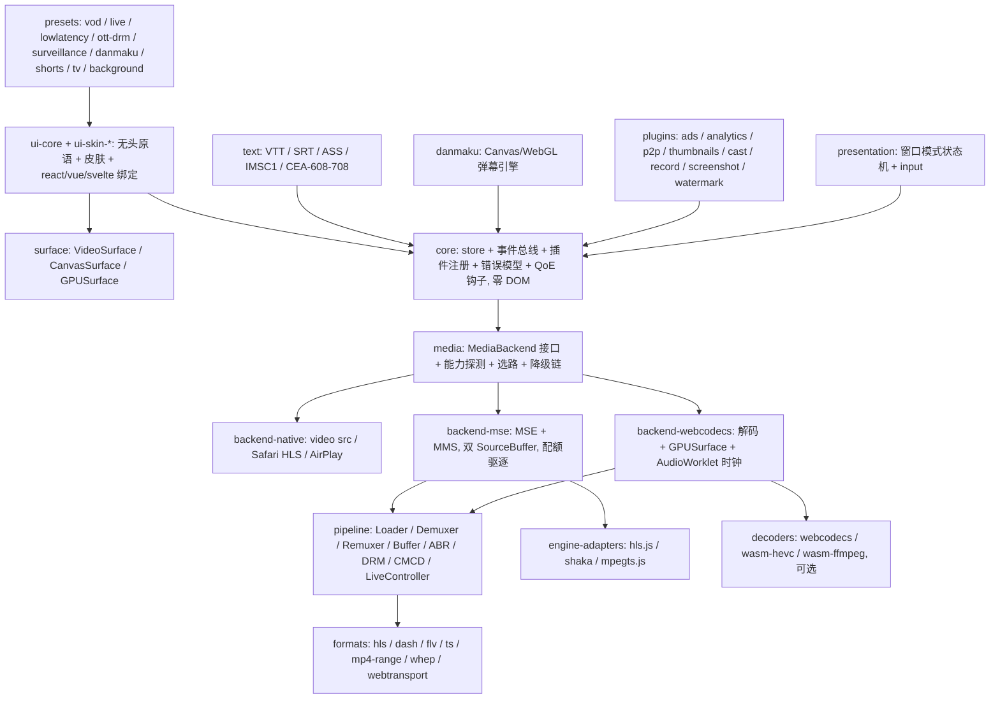
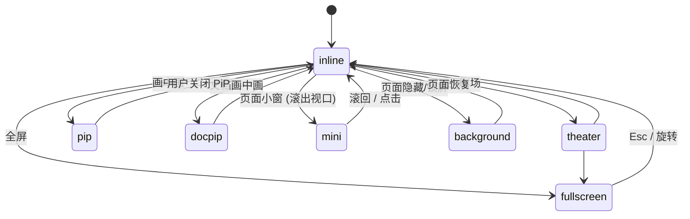

# Otter SPEC v0.1：通用 Web 播放器（TypeScript）

- 状态：草案
- 日期：2026-10-15
- 代号：Otter（水獭，工作代号，可随时更名；npm scope 建议 `@otter-player/*`，未核验占用）
- 关联：`RESEARCH.md`（调研）、`REUSE.md`（复用来源与等级）、`AGENT.md`（协作规则）、`docs/decisions/ADR-001-typescript-only.md`

---

## 0. 一句话定位

一个 100% TypeScript、可组合、引擎可插拔的通用 Web 播放器：任何场景都能通过组合现有模块覆盖，任何单一场景的产物只包含它用到的模块。集 hls.js、Shaka、dash.js、mpegts.js、xgplayer、video.js v10、Vidstack、Media Chrome、Jessibuca、B 站 nano 等各家之长，不从零造轮子。

## 1. 目标与非目标

### 1.1 目标

- 覆盖场景：短视频 / 长视频点播、直播与低延迟直播、国内 FLV/TS 直播、OTT 付费 DRM 与离线、监控多路 HEVC、B 站式弹幕站、剪辑/标注逐帧、背景视频、沉浸竖屏信息流、电视遥控器。
- 双路径架构：非 Apple 走 MSE，Apple 走原生 HLS 或 ManagedMediaSource，运行时确定性选路且可观测、可覆盖。
- 核心零 DOM 依赖，管线可跑在 Worker；全 ESM、`sideEffects: false`（唯一例外：纯 CSS 皮肤包为 `["*.css"]`，见 §14.4）、tree-shaking 友好。
- 首屏核心 ≤ 15KB gzip；默认皮肤 + ui-core + presentation + text ≤ 30KB；弹幕另加 ≤ 10KB。
- 无障碍 WCAG 2.2 AA，Vidstack 的 CVAA 清单作为验收标准。
- QoE 遥测从第一天内建：首帧、卡顿率、切档、错误、退出点、带宽估计、backend 类型。

### 1.2 非目标

- 不用 Rust / 不自写解码器。WASM 只作为可选 Decoder 插件边界，消费现成产物（libde265、ffmpeg.wasm、libmedia 解码器）。
- 不自写 EME/DRM 流程，DRM 走 Shaka 适配器。
- 不做服务端（打包、转码、许可证服务器、P2P tracker），只给打包规范建议。
- 不做 Roku（无 MSE）与 Flash 回退。
- 不支持 VVC/H.266（WASM 软解 1080p 不可用）。

## 2. 技术栈与工程纪律

- 语言：TypeScript strict + `exactOptionalPropertyTypes` + `noUncheckedIndexedAccess`。
- 仓库：pnpm monorepo，Vite 构建，Vitest 单测，Playwright 真机矩阵（iPhone Safari、Android Chrome、桌面三大浏览器、至少一台 Tizen/webOS），axe 无障碍扫描。
- 公开 API 用 `interface` 而非 class 继承，便于第三方实现适配器。
- 二进制数据走 Transferable 与 ArrayBuffer 池，避免 GC 抖动。
- 所有能力都是插件：Loader、Demuxer、Remuxer、ABR、DRM、Decoder、Renderer、文本轨、UI 功能。核心只认接口。
- 每种格式一个独立包，按需 `import()`。
- 每个典型场景一个 preset（预组合）。
- 复用等级 L1–L4 见 `REUSE.md` 与 `AGENT.md`；不设许可证限制（ADR-008）。

## 3. 总体架构



四条共享规则：
1. UI / Overlay / Presentation 只读 store、只派发 action，绝不直接碰引擎或 `<video>`。
2. 引擎可插拔是第一天就必须坚持的唯一设计约束，其他都可迭代。
3. 所有需要用户手势的 API（全屏、PiP、横屏锁、带声自动播放）必须在同一事件回调里同步调用，因此 `InputController` 直接触发这些 action，不经异步中间件。
4. 字幕、弹幕、UI 动画共享 Presentation 派发的同一个 `rAF` tick。

---

# 卷一：引擎层（Engine）

## 4. core

- 响应式 store：Zustand 风格 slices，`features` 数组决定哪些 slice 进 bundle（video.js v10 模式）。
- 事件总线：类型安全，支持 `once`、取消函数、trigger 溯源（Vidstack 的 triggers 思路）。
- 插件注册：`Plugin { id, deps?, install(ctx), uninstall() }`，按拓扑顺序安装。
- 错误模型：`{ type: 'network'|'media'|'drm'|'mux'|'other', details: string, fatal: boolean, recoverable: boolean, cause?: unknown }`，与 hls.js 错误分类对齐便于映射。
- QoE 钩子：统一 `qoe.emit(event)`，事件集见 §10。

## 5. media：MediaBackend 与选路

```ts
interface MediaBackend {
  readonly kind: 'native' | 'mse' | 'webcodecs';
  attach(target: HTMLMediaElement | HTMLCanvasElement): void;
  load(source: Source, opts: LoadOptions): Promise<void>;
  play(): Promise<void>; pause(): void; seek(t: number): void;
  setVolume(v: number): void; setMuted(m: boolean): void; setPlaybackRate(r: number): void;
  readonly tracks: TrackList;            // video / audio / text 统一模型
  selectQuality(id: string | 'auto'): void;
  readonly buffered: TimeRanges; readonly latency?: number;
  on<E extends keyof BackendEvents>(e: E, h: (p: BackendEvents[E]) => void): () => void;
  destroy(): void;
}
// BackendEvents：playback-change / tracks-change / quality-change / buffered-change / latency-change /
// first-frame / first-segment / bandwidth / dropped-frames / waiting / stalled / ended / error

interface BackendFactory {
  readonly kind: BackendKind;
  create(ctx: BackendContext): MediaBackend;   // ctx：选中的 format、FallbackStep、caps、qoe
}

interface FormatPlugin {
  readonly id: string;
  probe(source: Source, caps: Capabilities): number;              // 0..1 置信度
  backends(source: Source, caps: Capabilities): readonly BackendKind[]; // 本格式能喂的 backend
  createEngine(ctx: EngineContext): Engine;                       // 产出 pipeline 装配
}

interface Engine {                       // EngineContext 含 source / options / caps / backend / qoe / media / mms
  readonly formatId: string;
  readonly tracks: TrackList; readonly latency?: number;
  load(): Promise<void>;                 // 引擎库在此 import()
  selectQuality(id: string | 'auto'): void;
  on<E extends keyof EngineEvents>(e: E, h: (p: EngineEvents[E]) => void): () => void;
  destroy(): void;
}

interface Decoder {
  readonly id: string;
  supports(codec: string, caps: Capabilities): Promise<'hardware' | 'software' | false>;
  create(config: DecoderConfig): DecoderInstance;
}
```

M1 接口补充（`setVolume` 等、`BackendFactory`、`FormatPlugin.backends`、`Engine` 定稿）见 ADR-003。

### 5.1 能力探测（Capabilities）

一次性探测并缓存：`MediaSource` / `ManagedMediaSource` / `VideoDecoder` / `canPlayType('application/vnd.apple.mpegurl')` / `MediaCapabilities.decodingInfo` / `requestMediaKeySystemAccess` 各 key system / `documentPictureInPicture` / `pictureInPictureEnabled` / `screen.orientation.lock` / `wakeLock` / `SharedArrayBuffer` / `OffscreenCanvas` / WebGL2 / WebGPU / `pointer: coarse` / `dynamic-range` / `color-gamut`。

### 5.2 选路算法（确定性）

1. 探测能力。
2. 各 `FormatPlugin.probe()` 对源打分，取最高。
3. 按场景策略选 backend：
   - iPhone 上 HLS 且无 DRM、无切清晰度需求 → `native`。
   - iPhone 上需切清晰度或 DASH → `mse`（MMS），自动附加 AirPlay 备用源或 `disableRemotePlayback`。
   - HEVC 且无硬解 → `webcodecs`（WebCodecs 软解）→ 再降 WASM。
   - 其他 → `mse`。
4. 失败按降级链重试并上报 QoE：`webcodecs → wasm → mse → native`，每一步记录 reason。
5. 决策结果可通过 `router.explain()` 导出，并允许宿主以 `preferBackend` / `forbidBackend` 覆盖。

### 5.3 播放会话（media plugin）

`createMediaPlugin({ target, formats, backends, decoders?, policy? })` 是一个 core `Plugin`，也是 store 与 backend 之间唯一的桥：

- 处理 `load` / `play` / `pause` / `seek` / `set-volume` / `set-muted` / `set-playback-rate` / `select-quality` / `unload`，以及 `InputActionMap` 中的媒体类 action（`toggle-paused`、`seek-by`、`seek-to-percent`、`toggle-muted`、`volume-by`、`hold-rate`）。
- `load` 流程：探测能力 → 选路 → 创建 backend → 加载；遇到 fatal 错误按 `remaining` 降级重试，每一步都发出 `route` / `error` QoE 事件。
- 把 `BackendEvents` 写回 store（state 键见 ADR-003 第 6 条），并发出 §10 的 QoE 事件（startup、rebuffer、quality-switch、error、bandwidth、latency、dropped-frames、exit、route）。
- 同步调用 backend：action 在用户手势回调中派发时，`play()` 仍在同一调用栈内执行。

## 6. backends

### 6.1 backend-native
- `<video src>`；Safari HLS、AirPlay、原生 PiP、省电。
- 轨道：读 `videoTracks/audioTracks/textTracks`；画质切换不可用时上报 `quality: 'opaque'`。

### 6.2 backend-mse
- `MediaSource` 与 `ManagedMediaSource` 统一封装；`preferManagedMediaSource` 可配。
- 双 SourceBuffer（音视频分离，B 站模式），`BufferOperationQueue` 串行化 append/remove，配额驱逐策略。
- 响应 MMS `startstreaming / endstreaming / bufferedchange / quality`。
- 跨 codec 切档：仅在 `changeType` 可用且显式允许时执行，默认同编码族。
- 引擎来源二选一：`engine-adapters`（hls.js / Shaka / mpegts.js）或自研 `pipeline`。

### 6.3 backend-webcodecs
- 架构：Demuxer → `VideoDecoder`/`AudioDecoder` → 渲染缓冲 → `GPUSurface`；音频走 `AudioWorklet`，以 `AudioContext.currentTime` 为主时钟，视频被动对齐（找 ≤ 当前时间的最新帧，允许跳帧/丢帧）。
- 无音轨时仍用 AudioContext 时钟保持一致。
- 多实例共享 Worker 解码池，限制同时解码路数。
- PiP：`canvas.captureStream()` 喂隐藏 `<video>`。
- 三级降级：WebCodecs 硬解 → WASM 软解 → MSE（Jessibuca / EasyPlayer 模式）。

## 7. pipeline（自研管线，渐进替换适配器）

| 组件 | 接口要点 | 首批来源（见 REUSE） |
|---|---|---|
| Loader | fetch/XHR/WebSocket/WebTransport；Range；重试策略 `shouldRetry` 谓词；CMCD 注入 | hls.js loader、`@svta/common-media-library` |
| Demuxer | 输入 `ArrayBuffer`，输出 `{ init, samples, codec }` 纯函数 | hls.js tsdemuxer、mpegts.js flv-demuxer、mediabunny |
| Remuxer | ES → fMP4 | hls.js mp4-remuxer / mp4-generator |
| Buffer | 前后缓冲目标、空洞跳过、stall 检测 | hls.js buffer-controller、gap-controller |
| ABR | 规则叠加加权投票：Throughput、BOLA、InsufficientBuffer、ServerHint、自定义 | hls.js EWMA、dash.js 规则 |
| DRM | 仅通过 Shaka 适配器 | Shaka |
| LiveController | 追帧、动态倍速、多层看门狗（waiting / stalled / init stall）、回到直播 | mpegts.js |
| Text extractor | CEA-608/708、ID3、SEI | hls.js |

## 8. formats

| 包 | 职责 | 阶段 |
|---|---|---|
| `format-hls` | 先 hls.js 适配器；后期自研轻量 CMAF-HLS（对标 SPF 12KB） | M1 适配，M5 自研（ADR-009） |
| `format-dash` | Shaka 适配器；自研轻量 CMAF-DASH 可选 | M1 适配 |
| `format-flv` | 自研（demuxer 取自 mpegts.js） | M3 |
| `format-ts` | 自研（demuxer 取自 hls.js） | M3 |
| `format-mp4-range` | Range + moov 解析 + 分段加载换清晰度（xgplayer 模式） | M3 |
| `format-whep` | WebRTC WHEP 客户端 | M4 |
| `format-webtransport` | 实验 | 待定 |
| `format-file` | 本地文件 / Blob，走 WebCodecs | M4 |

## 9. decoders（可选插件，独立加载）

- `decoder-webcodecs`：默认。
- `decoder-wasm-hevc`：HEVC 软解 WASM（独立加载，不进核心，ADR-008）。
- `decoder-wasm-ffmpeg`：定制 ffmpeg.wasm（同上）。
- 多线程需 COOP/COEP，提供 `crossOriginIsolated` 检测与单线程回退。

## 10. QoE 事件集

`startup`（TTFF、首片耗时、backend、format、codec）、`rebuffer`（起止、时长、位置）、`quality-switch`（from/to、reason、auto/manual）、`error`（错误模型 + 降级路径）、`bandwidth`（EWMA 快慢）、`latency`（直播）、`dropped-frames`、`exit`（位置、累计观看）、`route`（选路决策与 explain）。内建 stats 面板直接消费这些事件。

---

# 卷二：渲染层（Presentation）

## 11. 分层与职责

| 子层 | 职责 | 包 |
|---|---|---|
| Surface 画面面 | 显示像素：`<video>` / `<canvas>` 2D / WebGL2 / WebGPU / OffscreenCanvas；适配、旋转、镜像、缩放平移、滤镜、HDR | `surface` |
| Overlay 叠加层 | 画面之上控件之下：字幕、弹幕、水印、广告、互动热点、海报、Loading、错误态 | `overlay-*`、`text`、`danmaku` |
| Chrome 控件层 | 控制栏、菜单、进度条、提示、手势区、键盘焦点 | `ui-core` + `ui-skin-*` + `input` |
| Window 窗口模式 | 内联、剧场、全屏、PiP、文档 PiP、页面小窗、后台音频、多宫格、外部窗口 | `presentation` |

## 12. surface

```ts
interface Surface {
  readonly kind: 'video' | 'canvas2d' | 'gpu';
  readonly element: HTMLVideoElement | HTMLCanvasElement;
  readonly contentRect: DOMRectReadOnly;        // 画面实际矩形，含黑边计算
  setFit(fit: 'contain' | 'cover' | 'fill' | 'none' | { ratio: number }): void;
  setTransform(t: { rotate: 0|90|180|270; mirror: boolean; zoom: number; pan: [number, number] }): void;
  setFilters(f: Partial<{ brightness: number; contrast: number; saturate: number; temperature: number; sharpen: number }>): void;
  snapshot(opts?: { type?: 'png'|'jpeg'; quality?: number }): Promise<Blob>;
  readonly colorInfo: { range: 'sdr' | 'hdr10' | 'hlg' | 'dv'; gamut: 'srgb' | 'p3' | 'rec2020' };
  onContentRectChange(h: (r: DOMRectReadOnly) => void): () => void;
  destroy(): void;                               // 断开 ResizeObserver 与监听（M1 补充）
}
```

| 实现 | 用于 | 能力 | 限制 |
|---|---|---|---|
| `VideoSurface` | native / mse | 浏览器合成、硬解、原生 PiP、AirPlay、省电 | 滤镜只能 CSS `filter`；iPhone 全屏被系统接管；snapshot 需同源或 CORS |
| `CanvasSurface` (2D) | WebCodecs 兜底、截图、低端机 | 简单、兼容 | 大分辨率吃 CPU |
| `GPUSurface` (WebGL2 / WebGPU) | WebCodecs 主路径、多宫格、HDR、色彩校正、超分 | YUV 直传 shader、tone mapping、锐化/降噪、一张画布多视口 | 上下文数量约 16 个上限，多路共享一个 canvas 分视口 |

尺寸全部靠 `ResizeObserver` + CSS `aspect-ratio`，不监听 `window.resize`。

## 13. overlay

```ts
interface Overlay {
  readonly id: string; readonly zIndex: number;
  mount(host: OverlayHost): void;               // host 提供 contentRect、安全区、tick、store
  tick?(now: number, mediaTime: number): void;  // 参与统一 rAF
  setSafeArea?(insets: Insets): void;
  destroy(): void;
}
```

Overlay 拿到的是画面实际矩形而非容器矩形（黑边时字幕仍贴画面底部）。

`Overlay` / `OverlayHost` / `Insets` 定义在 `surface` 包（ADR-002）。`OverlayHost` 提供 `root`（overlay 渲染用的图层元素）、`contentRect`、`safeArea`、`store`（只读视图）和 `onContentRectChange`；host 从统一的 rAF 中调用 `overlay.tick`。

### 13.1 字幕（text）
- 两条路径并存：原生 `TextTrack`（遵守系统偏好，样式不可控，Safari 全屏抢渲染）与自定义 `CueRenderer`。
- 自定义路径：WebVTT 实现 region / line / position / align / 自动避让；IMSC1/TTML 用 imscJS；ASS/SSA 基础样式 JS 渲染，特效用 libass WASM 可选插件；CEA-608/708 来自引擎 inband cue。
- 安全区：控制栏显示时字幕上移，Chrome 层把占位高度写回 store。
- 遵守 `::cue` 用户偏好与 `prefers-reduced-motion`。

### 13.2 弹幕（danmaku）

| 渲染方式 | 适用 | 特点 |
|---|---|---|
| CSS transform 轨道 | 低密度、需要可点击 | 每条一个 DOM，几百条以上掉帧 |
| Canvas 2D | 常规密度 | 一帧画一次，文本缓存成位图 |
| WebGL 批渲染 | 高密度、蒙版弹幕 | 文本 atlas，一次 drawcall |
| OffscreenCanvas + Worker | 主线程繁忙页面 | 滚动不被页面 JS 阻塞 |

语义：滚动/顶部/底部/逆向、seek 后重建、暂停与倍速同步、密度/透明度/字号/显示区域（25/50/75/100%）、屏蔽词与正则、防遮挡蒙版（服务端按帧 SVG 或 WebM 蒙版，前端 `mask-image` 或 shader alpha）、高级弹幕（定位/旋转/路径）。与字幕共享 tick。

### 13.3 水印与广告
- 静态 logo 用 DOM；防录屏跑马灯用 Canvas 低频随机位置，避免被 CSS 关闭。
- 广告 Overlay 只消费时间线 Interstitial 事件显示倒计时与可跳过按钮，UI 层不感知广告逻辑；CSAI 可接 IMA SDK。

## 14. ui-core / ui-skin / input

### 14.1 原语（Web Components，自带 ARIA）
`PlayButton`、`MuteButton`、`VolumeSlider`、`TimeSlider`、`TimeDisplay`、`LiveIndicator`、`Menu` / `MenuItem`、`Tooltip`、`Gesture`、`Poster`、`Spinner`、`Announcer`。每个只负责一个状态到一个 DOM 的绑定，样式通过 CSS 变量、`::part()` 与 slot 暴露。

### 14.2 功能组合
- 进度条：缩略图预览（VTT sprite 或 I-frame playlist）、章节分段、已缓冲区间、直播回看窗口与回到直播、拖动时间气泡。
- 设置菜单：画质（自动时显示当前实际档位）、倍速、音轨、字幕及样式、循环、弹幕设置。
- Stats for nerds：分辨率、码率、丢帧、缓冲长度、延迟、带宽估计、codec、backend 类型、选路 explain。
- 自动隐藏、空闲检测、`pointer: coarse` 下控件放大。

### 14.3 input：统一 action 映射

| 输入 | 默认映射 | 说明 |
|---|---|---|
| 单击 / 空格 / K | 播放暂停 | 移动端单击只切换控件显隐 |
| 双击左/右区 / J / L / 方向左右 | 快退快进 10s | 方向反馈气泡 |
| 双击中央 / F | 全屏 | |
| 长按 | 2x 倍速，松开恢复 | |
| 左半区上下滑 / 右半区上下滑 | 亮度 / 音量 | 亮度只能调自己的遮罩层 |
| 横向滑动 | seek 预览 | 松手才真正 seek |
| 双指捏合 | 电子放大 | |
| 上下方向键 / M / C / P / I | 音量 / 静音 / 字幕 / PiP / 小窗 | 全部可重映射 |
| 数字 0-9 | 跳到百分比 | |
| Tab / Shift+Tab / Esc | 焦点循环 / 关闭菜单退出全屏 | 只在模态（全屏）时把焦点困在播放器内；内联时 Tab 可以离开（WCAG 2.1.2，ADR-005 §5） |

### 14.4 皮肤
`ui-skin-default`、`ui-skin-minimal`、`ui-skin-tv`（大焦点、只用方向键）、`ui-skin-audio`。皮肤层只有 CSS：包内禁止任何 JS 入口，`"sideEffects": ["*.css"]`，可以用 JS `import`、`<link>` 或 CSS `@import` 引入（ADR-002 第 10 条）。

### 14.5 无障碍
WCAG 2.2 AA；全部控件键盘可达且有可见焦点；`prefers-reduced-motion` 关动画；`prefers-contrast` 换高对比皮肤；状态变化 `aria-live` 播报；Vidstack CVAA 清单为验收。

## 15. presentation：窗口模式状态机

```ts
type PresentationMode = 'inline' | 'theater' | 'fullscreen' | 'pip' | 'docpip' | 'mini' | 'background';

interface PresentationController {
  readonly mode: PresentationMode;
  readonly capabilities: Readonly<Record<PresentationMode, 'native' | 'emulated' | false>>;
  request(mode: PresentationMode, opts?: { userGesture?: Event }): Promise<PresentationMode>;
  exit(): Promise<void>;
  on(e: 'change' | 'denied', h: (p: { from: PresentationMode; to: PresentationMode; reason?: string }) => void): () => void;
}
```



每次迁移是 `request → 浏览器异步结果 → 确认或回滚`，不乐观更新。

| 模式 | API | 关键坑 |
|---|---|---|
| 全屏 | `container.requestFullscreen()`（对容器而非 video） | iPhone Safari 无元素全屏，只有 `video.webkitEnterFullscreen()` 进系统播放器，自定义 UI/弹幕/字幕全丢；解法是伪全屏（容器 `position: fixed` + `100dvh`、锁定 body），接受状态栏仍在 |
| 横屏锁定 | `screen.orientation.lock('landscape')` | 只在全屏内有效，Safari 不支持；伪全屏时用 CSS `rotate(90deg)` 模拟 |
| 视频 PiP | `video.requestPictureInPicture()` / Safari `webkitSetPresentationMode` | 只能放 `<video>`，弹幕字幕丢失；WebCodecs 路径用 `captureStream()` 喂隐藏 video；响应 `enterpictureinpicture` 切最小控件 |
| 文档 PiP | `documentPictureInPicture.requestWindow()`（Chrome 116+） | 整个播放器 DOM 搬进去，全部保留；要复制样式表，video 跨 document 移动会中断播放，移动前记录状态 |
| 页面小窗 | 自实现：`IntersectionObserver` 滚出视口后 `position: fixed` 到角落，可拖拽关闭 | 保留原位占位防抖动 |
| 剧场模式 | 纯布局，派发事件让宿主改容器尺寸 | 播放器不改页面布局 |
| 后台 | `visibilitychange` + `MediaSession` | 后台停弹幕和 GPU 渲染，音频继续；MMS `endstreaming` 要停取流 |
| 多宫格 | 多实例共享一个 `GPUSurface` 分视口或各自独立 | 共享 Worker 解码池，限路数，焦点一路出声，双击局部全屏 |
| 外部窗口 / 多标签 | `BroadcastChannel` 同步，同账号单实例出声 | |
| 投屏 | Remote Playback API / AirPlay `webkitShowPlaybackTargetPicker` / Cast SDK | iPhone MMS 必须有 AirPlay 备用源，与引擎层协同 |
| 常亮 | `navigator.wakeLock.request('screen')` | 全屏与播放中申请，暂停释放 |
| 系统媒体控件 | `navigator.mediaSession` 元数据、封面、上下首、seek 处理器 | 锁屏与耳机按键 |
| 沉浸竖屏信息流 | preset：全屏容器、`scroll-snap`、预创建相邻实例、首帧海报 | 不是新模式 |

## 16. 框架绑定与宿主集成

- 底座 Web Components + 框架无关响应式 store；提供 `react` / `vue` / `svelte` 薄绑定（hooks 与组件包装）。
- SSR 输出带 poster 的占位和 `<video>` 骨架，客户端 hydrate 后接管，避免 CLS。
- 宿主契约只有三条：传入 `Source` 与 `features`，监听事件，调 action。剧场、小窗位置、路由切换保活通过事件与配置交给宿主。
- Electron：加一条 IPC 把窗口模式映射到原生窗口（B 站 PC 端复用 nano 的模式）。

## 17. UIFeature 接口

```ts
interface UIFeature {
  readonly id: string;
  readonly slices?: StoreSlice[];
  readonly components?: CustomElementConstructor[];
  readonly hotkeys?: HotkeyMap; readonly gestures?: GestureMap;
  readonly overlays?: Overlay[];
}
```

---

# 卷三：包清单、场景矩阵、里程碑

## 18. 包清单

引擎：`core`、`media`、`backend-native`、`backend-mse`、`backend-webcodecs`、`pipeline`、`format-hls`、`format-dash`、`format-flv`、`format-ts`、`format-mp4-range`、`format-whep`、`format-file`、`engine-adapter-hlsjs`、`engine-adapter-shaka`、`engine-adapter-mpegts`、`decoder-webcodecs`、`decoder-wasm-hevc`、`decoder-wasm-ffmpeg`、`decoder-pool`（共享 Worker 解码池，ADR-008 §3）、`demux-mediabunny`（WebCodecs 路径的 demuxer，ADR-008 §2）、`qoe`。

渲染：`surface`、`presentation`、`input`、`ui-core`、`ui-skin-default`、`ui-skin-minimal`、`ui-skin-tv`、`ui-skin-audio`、`text`、`text-ass`、`danmaku`、`overlay-watermark`、`overlay-ads`、`overlay-thumbnails`、`react`、`vue`、`svelte`。

插件：`plugin-cast`、`plugin-analytics`、`plugin-p2p`（预留）、`plugin-record`、`plugin-screenshot`。

预设：`presets`。

划分原则：能单独删掉而不影响其他。

M0 接口落点（ADR-002）：

| 接口 | 包 |
|---|---|
| store / 事件总线 / `Plugin` / 错误模型 / QoE 事件集（§4、§10） | `core` |
| `MediaBackend`、`FormatPlugin`、`Decoder`、`Source`、`TrackList`、`Capabilities`、`Router` / `FALLBACK_CHAIN`（§5） | `media` |
| `Engine` / `EngineContext`（`FormatPlugin.createEngine` 的产物，M1 随适配器定稿） | `media` |
| `Surface`（§12）、`Overlay` / `OverlayHost`（§13） | `surface` |
| `PresentationController`（§15） | `presentation` |
| `InputAction`、`HotkeyMap`、`GestureMap`、`InputController`（§14.3） | `input` |
| `UIFeature`（§17） | `ui-core` |

依赖方向由 `scripts/check-boundaries.ts` 强制：`core` 无依赖；`media` 只依赖 `core`；渲染层包不得依赖 `backend-*` / `format-*` / `engine-adapter-*` / `decoder-*` / `pipeline`，反之亦然。

## 19. 场景覆盖矩阵

| 场景 | backend | 格式包 | 必带模块 | 体积目标：自有代码 (gzip，M1–M6 门禁) | 含第三方引擎 (gzip，M5 起逐步门禁) |
|---|---|---|---|---|---|
| 短视频 / 简单点播 | native 或 mse | mp4-range 或 hls | core + ui 最小皮肤 | < 30KB | 记录 |
| 长视频点播 + 多清晰度 + 字幕 | mse | hls / dash | abr + text + thumbnails | < 80KB | 记录 |
| 直播 + LL-HLS / LL-DASH | mse | hls / dash | live-controller + 追帧 | < 90KB | 记录 |
| 国内直播 / 电商 | mse | flv / ts / whep | live-controller + 看门狗 | < 70KB | 记录 |
| OTT 付费 + DRM + 离线 | mse | hls + dash（Shaka 适配） | drm + storage + ads | 适配器体积为主 | 记录 |
| 监控多路 + HEVC | webcodecs | flv / ts / ps | wasm-hevc 兜底 + GPUSurface 多画面 | WASM 另计 | 记录 |
| B 站式弹幕站 | mse | dash 音视频分离 | danmaku + 多编码探测 + 偏好持久化 | < 120KB | 记录 |
| 剪辑 / 标注 / 逐帧 | webcodecs | mp4 / webm 本地文件 | 帧精确 seek + 缩略图 | 按需 | 记录 |
| 背景视频 / Hero | native | mp4 | 无 UI | < 5KB | 记录 |
| 沉浸竖屏信息流 | mse | hls / mp4-range | preset shorts | < 60KB | 记录 |
| 电视遥控器 | mse | hls / dash | ui-skin-tv | < 90KB | 记录 |

体积口径（ADR-004、ADR-009）：「自有代码」指 Otter 各包及其非引擎 L1 依赖，不含 hls.js / Shaka / mpegts.js / WASM 解码器；「含第三方引擎」在此基础上加上该场景首次播放必须加载的引擎块。自有代码列为 M1–M6 门禁；含引擎列在自研 CMAF-HLS 引擎落地（M5）前只记录，M5 起对短视频 / 长视频点播场景门禁，M6 全部门禁。引擎库只能在 `Engine.load()` / `Decoder.create()` 中以 `import()` 按需加载，不得进入首屏 chunk。

## 20. 自研与复用的边界

自研并长期拥有（约占代码量 25–35%）：`core` 插件注册与错误模型、`MediaBackend` 三个适配器胶水、能力探测与选路、降级链与 QoE、`PresentationController`、`InputController`、`Surface` 抽象与 `GPUSurface`、弹幕 WebGL 批渲染、多宫格与 Worker 解码池、presets。

先适配后替换：HLS / DASH 引擎先以 `EngineAdapter` 包 hls.js 与 Shaka，DRM 直接用 Shaka。接口被真实引擎验证后，再写轻量 CMAF 引擎替换简单场景，复杂场景可一直保留适配器。

其余按 `REUSE.md` 的 L1–L3 填满。

## 21. 里程碑与验收

| 里程碑 | 引擎侧 | 渲染侧 | 验收 |
|---|---|---|---|
| M0 | monorepo 骨架、接口定义、CI（license 门禁、strict TS、Vitest、Playwright 矩阵、axe） | 同左 | 所有接口有类型与空实现；`pnpm build` 产出各包；license 门禁跑通 |
| M1 | `backend-native` + `backend-mse` + hls.js / Shaka / mpegts.js 适配器；选路与降级链；QoE 面板 | `VideoSurface` + 最小控件 | 全场景矩阵能播；iPhone MMS 条件自动处理；stats 面板有数据；`router.explain()` 可导出选路决策（真 iPhone / Android 延后到 M7，ADR-004 / ADR-009） |
| M2 | ABR 规则叠加、CMCD、错误恢复 | `ui-core` 原语、默认皮肤、字幕（VTT/IMSC/608）、`InputController`、无障碍 | axe 零严重问题；键盘全覆盖；Vidstack CVAA 清单通过 |
| M2.5 | — | 视觉系统：设计令牌、Lucide 图标集（ADR-006）、控制栏 / 进度条 / 顶部栏 / 中央反馈 / 移动端布局、设置菜单二级结构、stats 面板、字幕默认样式（`docs/design/UI-DESIGN.md`） | UI-DESIGN §11 七条（截图由用户目视）；M2 的 a11y、CVAA、体积门禁保持 |
| M3 | 自研 FLV/TS/fMP4 管线（含 SEI 中的 CEA-608）、`LiveController`（回到直播）、`format-mp4-range`（多档位无缝切换） | `presentation` 全模式（重点 iPhone 伪全屏与 Document PiP）、MediaSession、WakeLock、投屏（Remote Playback / AirPlay）、剧场；原生 TextTrack 回退；预览卡缩略图（VTT sprite / I-frame）；CVAA 字幕窗口（ADR-007） | 桌面真机 + CI WebKit / 模拟移动端全模式通过，capabilities 按环境如实报告，拒绝有 denied + reason；Document PiP 不中断；FLV 直播延迟 ≤ 2s 且 TTFF 不劣于 mpegts.js；mp4-range 切档无 `waiting`；回到直播 / 剧场 / AirPlay / Cast 有 e2e；首次 L2 vendoring 走完 vendor-sync 评审（`docs/reports/M3.md`） |
| M4 | `backend-webcodecs`、WASM 解码插件、`format-whep`、`format-file` | `GPUSurface`、多宫格、电子放大、滤镜 | 16 路 720p HEVC 可播；三级降级可观测 |
| M5 | 自研轻量 CMAF-HLS 引擎替换简单场景（原 M6，ADR-009 提前）；音视频分离 DASH 优化、多编码探测与偏好持久化 | `danmaku`（Canvas + WebGL + 蒙版）、水印 | 自研引擎在 §19 短视频 / 长视频点播场景替换 hls.js 后 TTFF 与 rebuffer 不劣于适配器，含引擎口径简单点播 < 30KB；5000 条/分钟弹幕 60fps；蒙版弹幕对齐 |
| M6 | presets 发布；体积收口 | `ui-skin-tv`、shorts preset、React/Vue/Svelte 绑定、SSR、文档站 | 体积预算全部达标（含 Hero < 5KB）；文档站上线 |
| M7 | 移动端与 TV 真机回归：M1–M6 全部场景与模式（原 M5.5，ADR-009 移至最后） | 同左 | 真 iPhone Safari、真 Android Chrome、至少一台 Tizen 或 webOS 全部场景通过并有报告；问题在本里程碑内修完 |

每个里程碑结束都跑同一份 Playwright 矩阵和 axe 扫描。M1–M6 的真机要求为桌面 Chrome / Firefox / Safari 真机加 CI 上的 WebKit 与模拟移动端（`emulated-*` 不计为真机）；真 iPhone / Android / TV 在 M7 对最终代码一次性补跑（ADR-004、ADR-009）。

## 22. 品牌与图标资产

- 图标方案：B「O 播放环」已定稿（2026-10-15），备选 A 水獭头保留作文档站吉祥物。
- 源文件与构建：`Assets/icon/*.svg`，`python3 scripts/build-icons.py` 输出 `Assets/icon/dist/`（PNG 全尺寸、favicon.ico/svg、otter.ico、otter.icns、PWA、OG 图）。
- 色板即 CSS 变量：`--otter-bg #243447`、`--otter-bg-deep #1E2D40`、`--otter-accent #1EE9E6`、`--otter-accent-deep #12C9D4`、`--otter-fg #FFFFFF`。`ui-skin-default` 必须以此为默认主题色。
- Web Components 前缀 `otter-`，CSS 变量前缀 `--otter-`，npm scope `@otter-player/*`（占用待核验）。
- 详细几何规格与使用规则见 `Assets/icon/README.md`。

## 23. 开放问题

- Q1：正式项目名与 npm scope（当前 Otter 为工作代号）。
- Q2：video.js v10 GA 后，是 L2 vendoring 其 core store，还是保持自写同形状以避免跟随其 API 变动。
- Q3：自研轻量 CMAF 引擎与 SPF 的关系，是复用 SPF 组件还是独立实现。
- Q4：P2P-CDN 插件是否纳入 v1 范围。
- Q5：WebTransport / MoQ 是否等标准稳定再做。
- Q6：是否提供 Electron 专用包。
