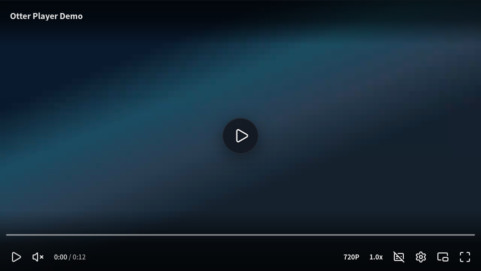
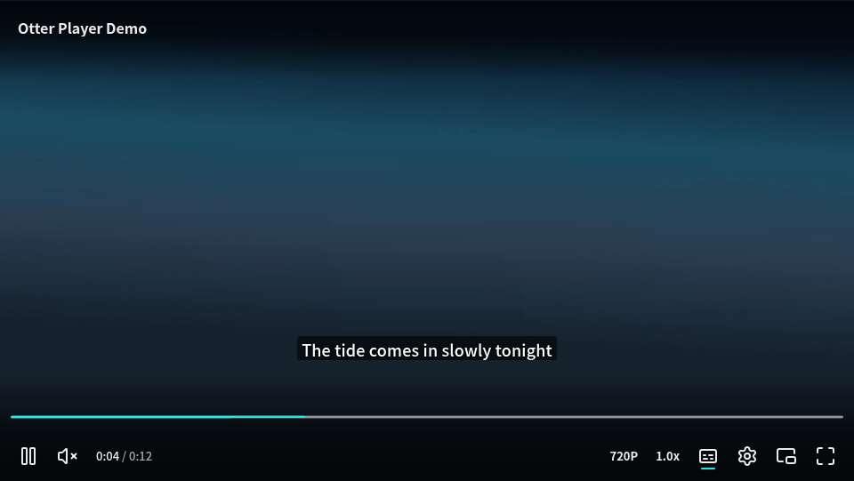
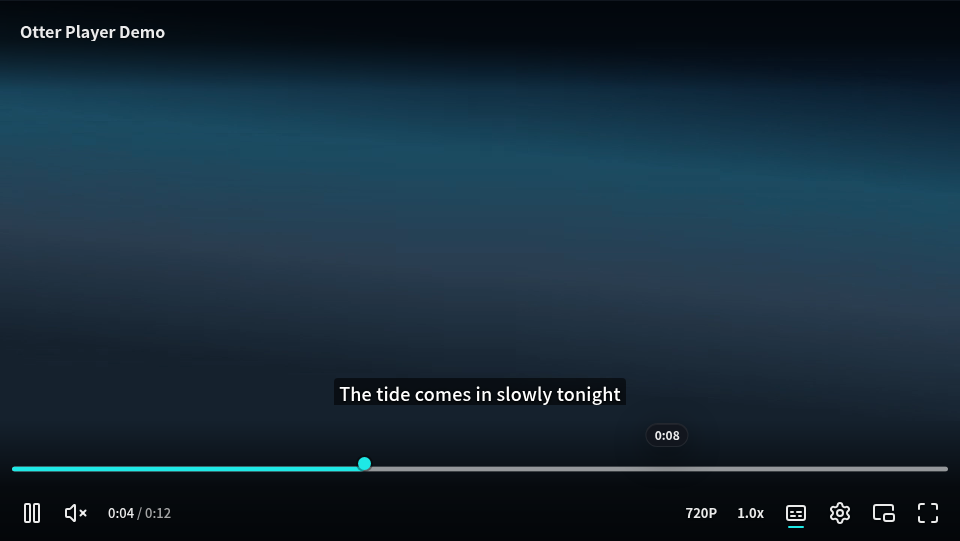
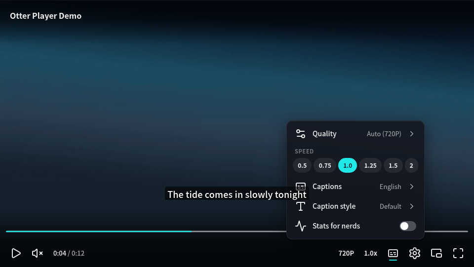
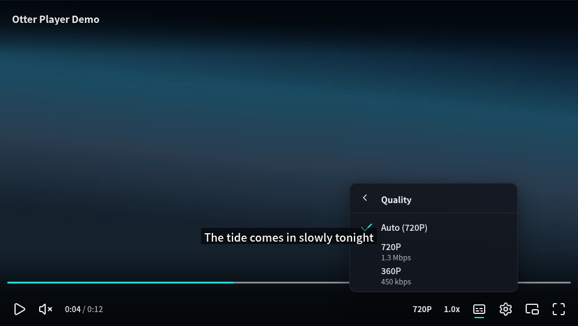
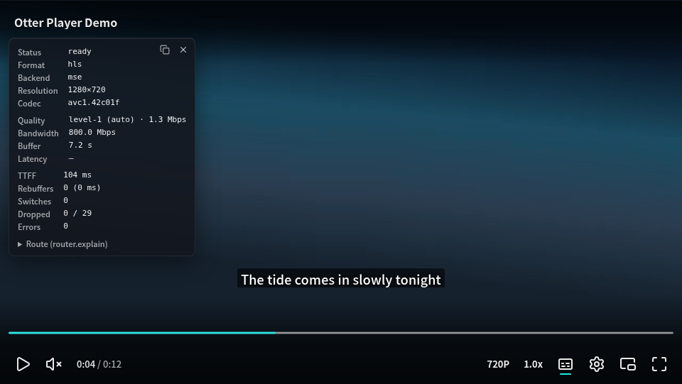
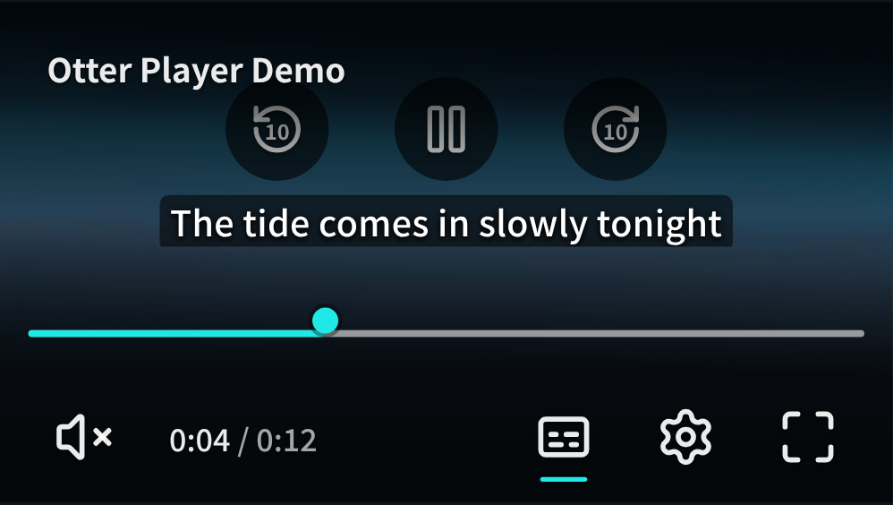

# M2.5 验收报告（视觉系统）

- 日期：2026-10-19
- 提交：`main`（M2.5 实现 45e5cc1 起）
- 关联：`docs/design/UI-DESIGN.md` v1（§4–§11）、`Assets/design/mockup-*.png`、ADR-006

## 结论

UI-DESIGN §11 的七条验收里，第 2–7 条已有自动化证据；第 1 条（风格一致）请你对照下面的截图目视验收。store、action、QoE 事件与 ARIA 模式都没有改动。M2 的 a11y、CVAA 与体积门禁全部保持通过。

| §11 验收项 | 状态 | 证据 |
|---|---|---|
| 1. 五张对照截图与 mockup 风格一致 | ⏳ 待你目视 | 下文「截图」；生成方式：`OTTER_SCREENSHOTS=1 pnpm e2e e2e/screenshots.spec.ts`，画面用专门的演示片源 `e2e/media/demo`（深色渐变，720P / 360P 两档 + 一条字幕） |
| 2. 图标来自同一集合，无占位图形 | ✅ | 全部来自 Lucide（ISC，L1）；Lucide 没有的 live 点、spinner、剧场按同一网格自绘（ADR-006） |
| 3. 任意画面上文字 / 图标对比度 ≥ 4.5:1 | ✅ | `e2e/visual.spec.ts`：画面换成纯白、纯黑、彩条，逐个控件在截屏中取中心区域最亮的像素计算 WCAG 对比度。Chrome / Firefox / 模拟 Android 通过。按 §4.1 原始 scrim 值，标题只有 2.0:1，因此 scrim 加深（ADR-006 §3） |
| 4. 动效时长与曲线；reduced-motion 下无动画 | ✅ | `e2e/visual.spec.ts`：显示 150 ms ease-out、隐藏 250 ms ease-in；`prefers-reduced-motion: reduce` 下控制栏与 shadow 内元素的过渡时长都是 0 |
| 5. 设置菜单二级结构可键盘往返，焦点不丢失 | ✅ | `e2e/visual.spec.ts`（一级 → ArrowRight → 二级 → 选择后回到原行 → ArrowLeft → Esc 回到触发按钮），以及 `ui-core` 单测 |
| 6. 皮肤 CSS ≤ 8 KB gzip；图标按需；短视频场景自有代码 ≤ 30 KB | ✅ | size-limit 新增门禁：皮肤 CSS 1.89 KB；短视频 23.97 KB；`ui-skin-default + ui-core + presentation + text` 27.06 / 30 KB |
| 7. M2 的 a11y 与 CVAA 用例保持通过 | ✅ | 本地 e2e 102 个用例通过（Chrome / Firefox / 模拟 Android，不含 `@network`）；单测全部通过；axe 零 serious / critical |

## 截图（桌面 Chrome，播放器宽 960 px）

1. 海报态：大播放按钮（72 px 玻璃圆）、顶部标题、底部 scrim

   

2. 播放中、控件显示：三层进度条、左组（播放 / 音量 / 时间）、右组（`720P`、`1.0x` 文字按钮，字幕、设置、PiP、全屏），字幕为新的默认样式

   

3. 悬停进度条：加粗到 5 px，出现 13 px 拖动圆点和时间胶囊

   

4. 设置菜单
   - 一级：图标 + 标签 + 当前值 + chevron，倍速分段控件，统计开关

     

   - 二级：返回行，清晰度双行（档位 + 码率）

     

5. Stats 面板：分组、两列、数值等宽、复制与关闭按钮，位于顶部 scrim 之下

   

移动端（模拟 Android）：中央显示「后退 10 秒 / 播放 / 前进 10 秒」，按钮 48 px，进度条拖动圆点常显：

其余移动端截图与上面同名，见 `docs/reports/m2.5/emulated-android-*.png`。

## 范围落实

| UI-DESIGN 条目 | 实现 |
|---|---|
| §4 设计令牌 | 皮肤在 `:root` 定义全部 `--otter-*` 变量；原语 shadow CSS 的回退值与之相同，没有皮肤也能正确显示 |
| §5 图标 | Lucide；每个状态的图标都渲染出来，切换时 120 ms 交叉淡入；按元素注册时 tree-shake |
| §6.1 控制栏 | scrim 是伪元素，所以控制栏盒子本身就是字幕安全区；左右两组；音量悬停或聚焦时展开 72 px；宽度 < 640 px 时文字按钮收起 |
| §6.2 进度条 | 底轨 / 已缓冲 / 已播三层；悬停 3 → 5 px，并出现 thumb 与预览卡；方向键 5 s，Shift + 方向键 10 s；触控目标 24 px（axe target-size） |
| §6.3 顶部栏 | 宿主标记 `[data-otter-top]` / `[data-otter-title]`，与控制栏同节奏显隐 |
| §6.4 中央反馈 | 大播放按钮（仅海报态）；快进快退、音量、亮度、倍速的反馈胶囊；加载超过 800 ms 才显示 spinner；错误卡片带重试 |
| §6.5 移动端 | 中央三按钮，加暗色圆底；48 px 按钮；隐藏音量滑块与文字按钮 |
| §7 设置菜单 | 两级结构；倍速分段控件；字幕样式二级页带实时预览；统计开关（`menuitemcheckbox`） |
| §8 Stats | 分「播放 / 网络 / 质量」三组加 Route 折叠区；复制为 JSON；关闭 |
| §9 字幕 | 1080p 画面上 36 px（最小 15 px）、字重 500、0.55 半透明底、圆角 4 px、每行独立底色；距画面底 8%；控制栏显示时再上移「被遮挡高度 + 8 px」，150 ms 过渡 |
| §10 状态 | 悬停放大 1.1；tooltip 400 ms 后出现；焦点环 2 px、偏移 2 px、跟随圆角；禁用 0.4；直播落后超过 3 s 时显示「回到直播」胶囊 |

## 与设计稿的差异（需要你确认）

- **scrim 比 §4.1 深**：为满足 §11.3 的 4.5:1。按原值，纯白画面上标题 2.0:1，测试会失败（已用原值验证过一次，ADR-006 §3）。
- **倍速**：按 §7 文字用分段控件，没有采用 mockup 里一级菜单的「Playback speed Normal >」行。
- **悬停预览卡只有时间胶囊**：缩略图槽位（160×90）已经留好，但还没有缩略图来源（`overlay-thumbnails` 仍是空实现），章节名同理。
- **「回到直播」只做了视觉**：点击需要新的 action（seek-to-live），按约定不改 store，放到 M3 的 LiveController。剧场、AirPlay、Cast 按钮依赖 M3 presentation 的 capabilities，本轮没有加。
- **「下一个」按钮**：没有播放列表概念，暂不出现。
- **令牌改名**：`--otter-buffered`（颜色）改为 `--otter-buffered-color`，因为原名已经是缓冲百分比变量（ADR-006 §3）。
- **小屏手机**：字幕最小 15 px，在约 380 px 宽的播放器上占画面比例偏大。是否允许更小的下限，请你目视后决定。
