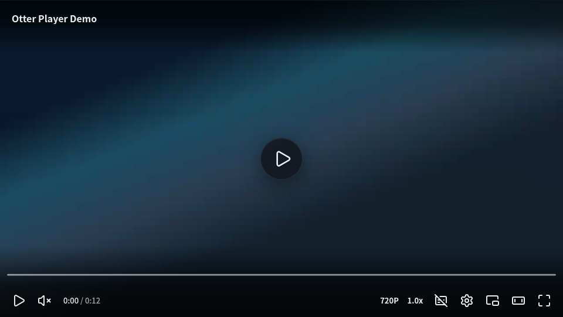
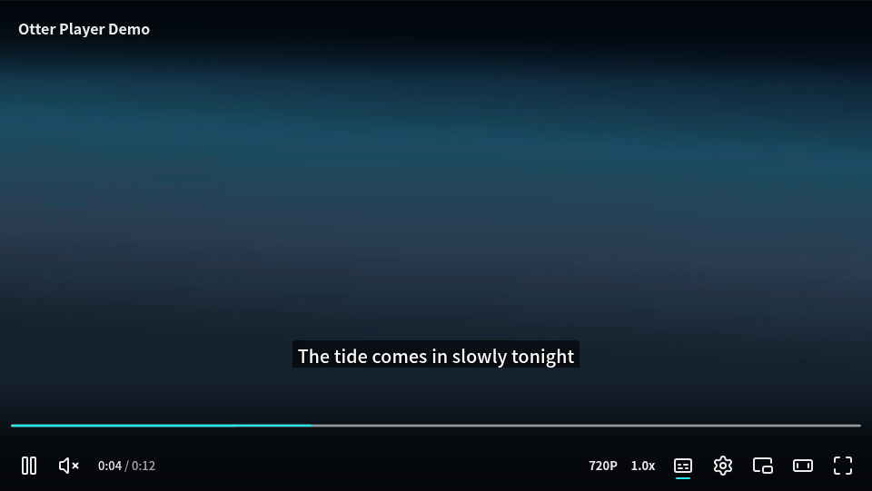
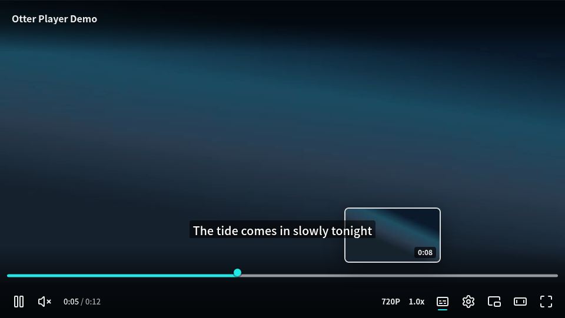
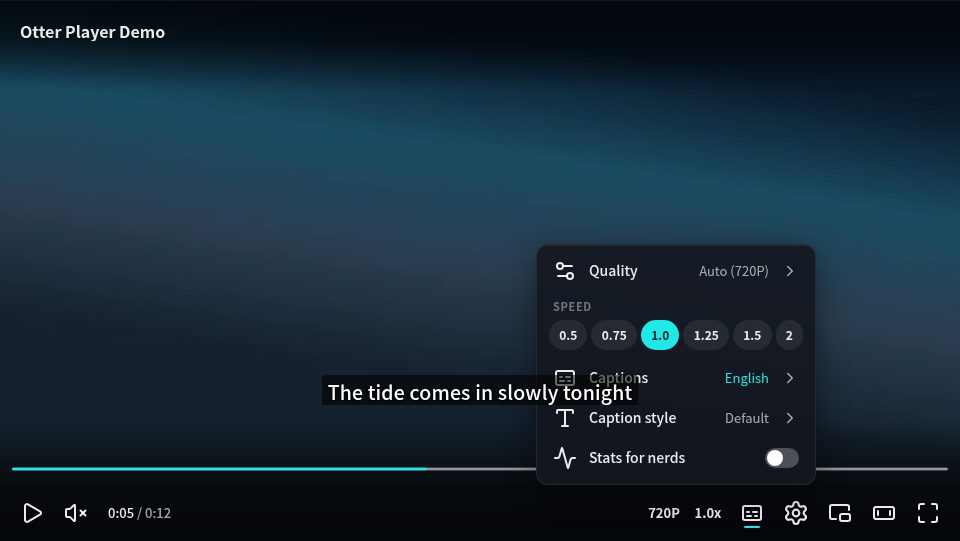
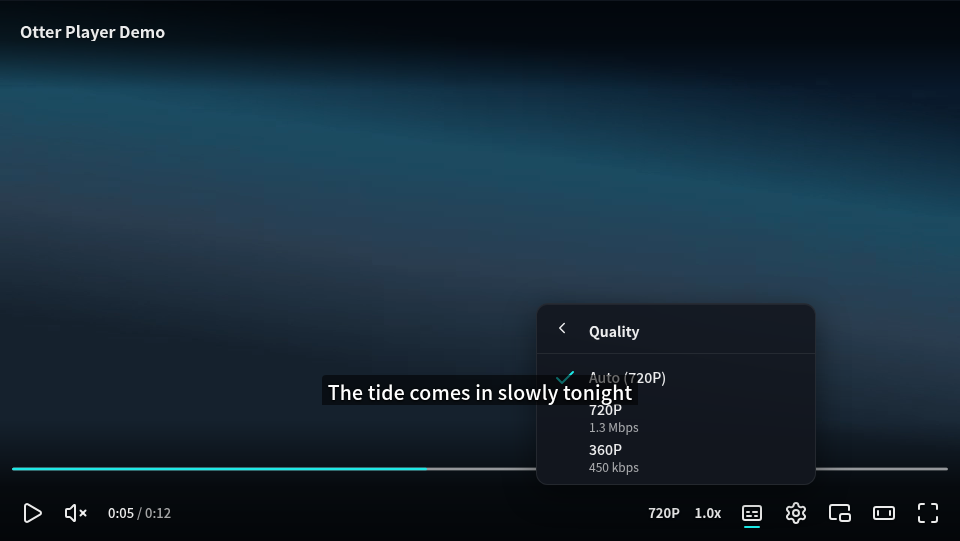
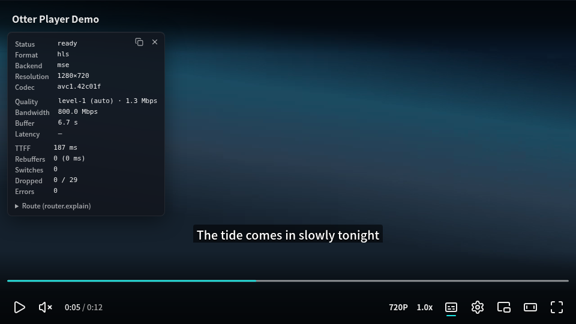
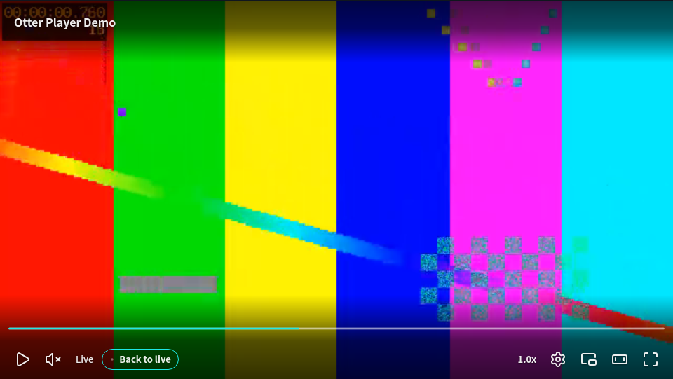
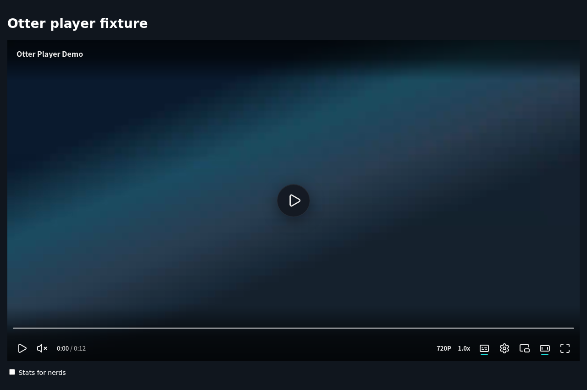
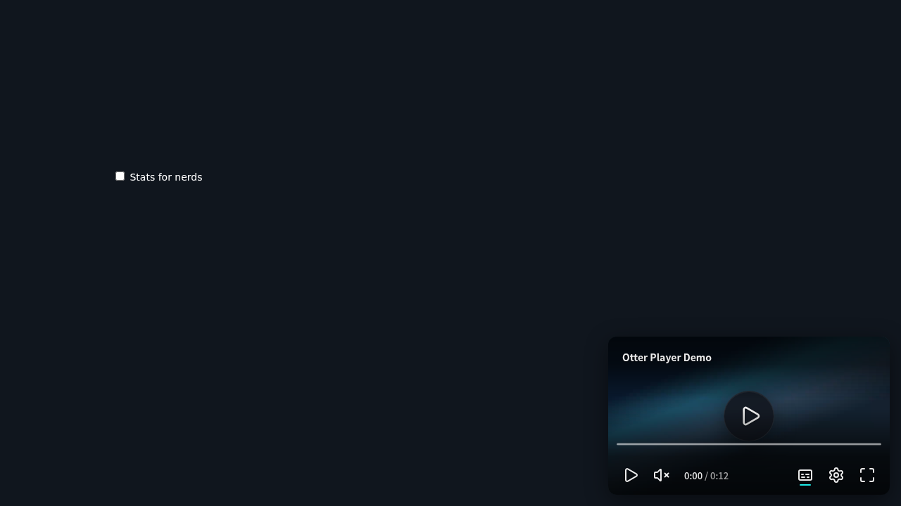

# M3 报告：自研管线、LiveController、mp4-range、presentation 全模式、缩略图

- 日期：2026-10-20
- 关联：SPEC §7、§8、§13、§15、§21；ADR-007（M3 契约）；ADR-004（真机口径）；REUSE §3–§5
- 提交范围：`74bfe66`（ADR-007）至 `5d5f9ae`，全部直接提交在 main，CI 绿

## 结论

SPEC §21 与 ADR-007 列出的 M3 验收项，以及你在 M2.5 验收时追加的项目，全部完成，**提请验收**。有四件事需要你决定或确认，见文末「需要你确认的事项」。

## 验收项

| # | 验收项 | 结果 | 依据 |
|---|---|---|---|
| 1 | SPEC §15 的每种模式在 Chrome / Firefox / WebKit（CI）与模拟 iPhone 上都有 e2e | ✅ | `e2e/presentation.spec.ts` 共 14 个用例，在 `desktop-chrome`、`desktop-firefox`、`emulated-android`、`desktop-safari`、`emulated-iphone`、`real-windows-edge` 上都跑。覆盖 inline、theater、fullscreen（原生、伪全屏、iPhone 系统播放器）、pip、docpip、mini、background，以及 MediaSession、WakeLock（单测）和投屏 |
| 2 | capabilities 对每个环境如实报告 native / emulated / false | ✅ | 见「各环境能力」。e2e 在页面里独立探测一遍，再和控制器报告的值逐项比较，报告为 `native` / `emulated` 的模式必须真的能进入 |
| 3 | 每次迁移都是 request → 确认或回滚，拒绝时发出 denied 事件和 reason | ✅ | 单测覆盖 `notAllowed`、`noUserGesture`、`busy`、`unsupported`、`dismissed`；e2e 覆盖无手势请求全屏被拒并回滚、`background` 只能被动进入（`unsupported`）、无头 WebKit 拒绝打开 PiP 窗口后回滚（见「已知限制」） |
| 4 | Document PiP 迁移不中断播放 | ✅ | Chrome、Firefox、真机 Edge：迁移前后每 50 ms 采样一次，`paused` 始终为 false，播放头没有倒退，也没有超过墙钟 + 0.5 s 的跳变。关闭窗口后播放器回到原位，仍在播放。WebKit 和 iPhone 没有 Document PiP，报告为 `false`，请求时返回 `unsupported` |
| 5 | cn-live-flv 用自研 FLV 管线替换 mpegts.js 适配器后，延迟 ≤ 2 s，TTFF 不劣于适配器 | ✅ | 见「cn-live 基准」：TTFF 中位数 38 / 56 ms（适配器 575 / 603 ms），画面延迟中位数 0.10 s（适配器 0.64 / 0.66 s）。自研管线从 `22a0205` 起是默认引擎 |
| 6 | mp4-range 场景无缝切换清晰度 | ✅ | `e2e/mp4-range.spec.ts`：手动先降后升、ABR 自动升档，两种情况下分辨率都会变化，`waiting` 为 0，`rebufferCount` 为 0，播放头一直前进 |
| 7 | 真机按 ADR-004 | ✅ | 真机 Windows Server 2022 + Edge 153（有界面）：单测 317 / 317，e2e 64 通过、0 失败，4 个跳过都是设计如此（见「测试矩阵」）。手机真机按 ADR-004 在 M5.5 回归 |
| 8 | 「回到直播」、剧场、AirPlay、Cast 四个按钮可用，并有 e2e | ✅ | 回到直播：`e2e/pipeline.spec.ts`（暂停后落后 → 胶囊出现 → 一次点击回到直播边缘并继续播放）。剧场：`presentation.spec.ts`（宿主把播放器放宽，`aria-pressed`）。Cast / AirPlay：替换了浏览器 API 的 e2e，断言按钮按可用性出现、点击时在同一个手势内调用 `prompt()` 或 `webkitShowPlaybackTargetPicker()`，并且状态跟随连接事件变化 |
| 9 | hover 预览卡显示缩略图，VTT sprite 与 I-frame playlist 两种来源各一个用例 | ✅ | `e2e/thumbnails.spec.ts`：sprite 用例断言 `background-position` 是对应的小块（`-160px 0px`、`-480px 0px`）；I-frame 用例断言 canvas 为 320×180，并且 20% 以上的像素非空 |
| 10 | 报告附一组与 M2.5 同机位的截图 | ✅ | 见「截图」，与 M2.5 机位相同，另外加了回到直播、剧场和页面小窗三张 |
| 11 | 第一次 L2 vendoring：`vendor/<project>/UPSTREAM.json` 与 `scripts/vendor-sync.ts` 的 diff 报告作为流程验收 | ✅ | 见「L2 vendoring 流程」：完整走了两轮「漂移 → 报告 → 评估 → 合入或记录理由」，其中一轮合入了 hls.js 上游的两个修复 |

M2.5 验收时追加的项目：

| 项目 | 结果 | 提交 |
|---|---|---|
| 右组按钮间距与左组统一；时间胶囊改成预览卡的缩小版；菜单里已开启轨道的 Captions 值用 accent 色；stats 对默认估值显示 (est.)、对未测量显示 — | ✅ | `f5f292d` |
| 字幕字号 `max(13px, 画面高度 × 3.6%)`，CVAA 字号作用于该基准，UI-DESIGN §9 已更新；§4.1 的 scrim 改为实际值 | ✅ | `f5f292d` |
| REUSE §4 的 media-captions 条目标注「上游存在未修复 XSS，仅使用解析器，禁止调用其渲染函数」；boundaries 门禁禁止调用这些渲染函数 | ✅ | `f5f292d` |

M2 遗留给 M3 的项目：

| 项目 | 结果 |
|---|---|
| presentation 完整状态机，替换 M2 的过渡插件 | ✅ `c0918c1` |
| 原生 `TextTrack` 字幕路径 | ✅ `bf8e138`：视频 PiP 和 iPhone 系统全屏时自动切到原生字幕，宿主也可以设 `mode: 'native'` 固定使用 |
| 608 在自研管线上解码 | ✅ `e3c10f2`：TS 和 FLV 都从 SEI 中取 cc_data，有内容的通道作为 `captions` 轨道出现 |
| 「回到直播」按钮 | ✅ `17b194b` |
| 字幕窗口颜色：M3 评估是否加 window 层 | ✅ 结论是加上，`427d987`：47 CFR §79.103(c) 把窗口颜色与不透明度列为单独的一项 |

## 各环境能力

e2e 里由控制器报告。每个值都和页面内独立探测的结果比较过；凡是报告为 `native` / `emulated` 的模式，都必须能真正进入。

| 环境 | inline | theater | fullscreen | pip | docpip | mini | background |
|---|---|---|---|---|---|---|---|
| Chrome（无头，Linux） | native | emulated | native | native | native | emulated | native |
| Firefox（无头，Linux） | native | emulated | native | native | native | emulated | native |
| 真机 Edge 153（Windows Server 2022，有界面） | native | emulated | native | native | native | emulated | native |
| 模拟 Android（Chromium） | native | emulated | native | native | native | emulated | native |
| WebKit（macOS 15 CI，desktop-safari） | native | emulated | native | native | false | emulated | native |
| 模拟 iPhone（WebKit，套用 iPhone Safari 的 API 形态） | native | emulated | emulated（伪全屏；可选系统全屏） | native | false | emulated | native |

说明：

- Playwright 的 Firefox 构建提供 `requestPictureInPicture` 和 `documentPictureInPicture`，两者在无头模式下都能真正进入，所以报告为 `native`。能力只靠特性探测，不按浏览器写死（RESEARCH §1）。
- 模拟 iPhone：Playwright 的 iPhone 实际是桌面 WebKit 加上 iPhone 的视口和 UA，本来就有元素全屏。e2e 用 init script 套上 iPhone Safari 的 API 形态：去掉元素全屏和 Document PiP，`<video>` 上提供 `webkitEnterFullscreen`。这样跑的是伪全屏和系统全屏两条路径。真 iPhone 的结果留到 M5.5。

## 引擎侧

### 自研 FLV / TS / fMP4 管线（ADR-007 §2）

- `@otter-player/pipeline/transmux`（按需加载，29.4 KB gzip）：FLV 用 mpegts.js 的 FLV demuxer（L2），TS 用 hls.js 的 TS demuxer（L2），两者都接 hls.js 的 fMP4 remuxer（L2）。FLV 轨道映射到 hls.js 的样本模型，这样只需维护一个 remuxer。
- `engine-pipeline`：fetch 流式读取 → transmuxer → MSE sink。加载阶段出现媒体错误时回退到 mpegts.js 适配器（`withAdapterFallback`，网络错误不回退）。基准测试的 40 次运行里一次回退都没有发生。
- CEA-608：SEI 中的 A/53 cc_data 在 TS 路径上由 hls.js demuxer 的 userdata 轨道取出，在 FLV 路径上映射样本时解析 SEI NAL。解码器（hls.js 的 608 解析器，L3）从 `text` 移到了 `pipeline`，单独作为 `@otter-player/pipeline/captions` 入口，收到第一段字幕数据时才加载。解出的 cue 以 in-band `text-cues` 交付，和 hls.js / Shaka 路径一致；渲染层不再带 608 代码。

### LiveController（ADR-007 §3）

- 追帧、倍速同步、起播卡住时跳过，规则来自 mpegts.js（L3），写成纯函数；目标延迟默认 1 s；用户自己设的倍速不会被覆盖。
- `seekToLive()` 进入了 Engine / MediaBackend 契约，五种引擎都有实现：自研管线用 LiveController；hls.js 用 `liveSyncPosition`；Shaka 用 `goToLive()` 或 `seekRange().end`；mpegts.js 用缓冲末尾 − 1 s；原生用 `seekable` 末尾 − 3 s。

### cn-live 基准（`e2e/bench-cn-live.spec.ts`，`OTTER_BENCH=1`，每组 10 次）

| 浏览器 | 引擎 | TTFF 中位数 | 缓冲延迟中位数 | 画面延迟中位数 / 最大值 | 回退 |
|---|---|---|---|---|---|
| Chrome | 自研管线 | 38 ms | 0.33 s | 0.10 s / 0.10 s | 0 |
| Chrome | mpegts.js 适配器 | 575 ms | 0.78 s | 0.64 s / 0.67 s | 0 |
| Firefox | 自研管线 | 56 ms | 0.32 s | 0.10 s / 0.11 s | 0 |
| Firefox | mpegts.js 适配器 | 603 ms | 0.78 s | 0.66 s / 0.68 s | 0 |

原始数据在 `docs/reports/m3/bench-cn-live-*.json`。测的是本地按节奏推送的 HTTP-FLV 流；「画面延迟」是画面相对推流时钟的距离，也就是观众实际看到的延迟。

### format-mp4-range（ADR-007 §4）

- `Source.renditions` 用来描述同一节目的多个 MP4 档位，各档位的关键帧必须在同一时刻。mp4box.js 2.4.1（L1，BSD-3）负责读 moov：先读文件头，moov 在文件末尾时再读尾部；然后切出与关键帧对齐的 fMP4。引擎每次用 Range 请求读取约 4 s 的数据，缓冲目标 30 s。
- 切档：从视频缓冲末尾处的关键帧开始追加目标档位的 init 段和后续分段，音频从音频缓冲末尾开始。已缓冲的内容一律不清空，所以不会出现 `waiting`。ABR 用 M2 的规则栈。
- 单个文件仍然走原生 `<video src>`。Range 引擎在第一次使用时才加载（`5d5f9ae`），所以只有渐进视频的页面不会带上它。
- xgplayer-mp4 的分段策略只看了思路，没有拷贝代码，所以在 REUSE 里登记为 L3 参考，而不是 L2。

## 渲染侧

- **presentation**：`createPresentationController` 实现了 SPEC §15 的全部模式。迁移时先同步调用浏览器 API（保住用户手势），确认之前 `pending` 是目标模式，拒绝时回滚并发出带原因的 `denied`。iPhone 上的伪全屏会锁住页面滚动，自定义 UI、字幕和以后的弹幕都保留；也可以选择系统全屏（`request('fullscreen', { system: true })`），这时 `videoOnly` 为 true。Document PiP 把整个播放器根节点移进 PiP 窗口，移动前记录播放状态，移动后按需恢复。页面小窗在播放器滚出视口时自动出现（`autoMini`），原位留占位元素防止页面跳动。只有自动打开的小窗会在滚回时自动关闭。退出全屏或 PiP 后回到下面的布局模式：从剧场进入的，就回到剧场。
- **伴随行为**：全屏时如果画面是横的，尝试锁定横屏，失败时不报错。WakeLock 在播放且页面可见时持有。MediaSession 设置元数据，处理 play / pause / seekbackward / seekforward / seekto，并更新 positionState。投屏：Remote Playback API（Cast 按钮）和 WebKit AirPlay 选择器。在 Safari 上 Remote Playback 本身就是 AirPlay，所以那里只显示 AirPlay 按钮。这些伴随功能在插件安装时作为一个 1.2 KB 的按需块加载，不进首屏。
- **新按钮**：`otter-theater-button`、`otter-cast-button`、`otter-airplay-button`。中英文文案都有，按能力或可用性显示，点击时同步派发。
- **缩略图**：`media` 里新增 `ThumbnailProvider` 契约。`overlay-thumbnails` 提供 `createVttThumbnails`（用 media-captions 的 `parseText`）和 `createThumbnails`（有 `Source.thumbnails` 时用 WebVTT，否则用引擎的 I-frame）。hls.js 适配器用 `createIFramePlayer` 把 I-frame 渲染到离屏 `<video>`，再画到 canvas；节流为每 200 ms 最多一次，并绕开了 hls.js 1.7 首次加载的两个竞态（RESEARCH §1）。ui-core 的 `provideThumbnails(root, provider)` 和 `provideStore` 是同一套上下文机制。预览卡里 sprite 小块会缩放到卡片大小，解码帧画在 canvas 上。
- **原生 TextTrack**：选中的轨道以 VTTCue 镜像到 `<video>` 上的 TextTrack，按需加载（0.45 KB）。这条路径用的是系统字幕偏好，不带 CVAA 样式（ADR-007 §6）。
- **字幕窗口**：`CaptionStyle.window` / `windowOpacity` 作用于整条 cue 的外框（`--otter-cue-user-window`），默认透明。设置菜单提供半透明和不透明两档。
- **stats 面板**：改成第一次显示时才加载视图，为首屏省下约 1.1 KB。

## L2 vendoring 流程（流程验收）

1. **拷贝**：`vendor/hls.js`（17 个文件，Apache-2.0，固定在 `e5ff358` = v1.7.3）和 `vendor/mpegts.js`（9 个文件，固定在 `791bac8` = v1.8.2，JS 源码转成了 strict TS）都是私有 workspace 包，由 `pipeline` 预打包。每个文件都有 `// Derived from …` 头，`UPSTREAM.json` 记录了文件清单、`ownFiles` 和逐条的 `localChanges`；`check-vendor` 门禁检查这三者以及 THIRD_PARTY_NOTICES。`scripts/vendor-strictify.ts` 用 TS 5.9 编译器 API 给缺少边界证明的下标读取机械地加上非空断言，其余改动是手工完成的，都写进了 `localChanges`。
2. **漂移报告**：`scripts/vendor-sync.ts` 对每个漂移的文件输出固定 commit 与上游默认分支之间的 unified diff。上游提交里出现 MSE / iOS / Safari / WebKit 等关键词时标为「一周内跟进」。CI 的定时任务把报告写进 job summary。
3. **第一轮（2026-10-19）**：shaka-player 测试资源（L3）有漂移，评估后不合入，原因记在 syncLog：只是新增了 DD / MKV 标记，保留的资源没有变化。
4. **第二轮（2026-10-20，两份 L2 拷贝的第一次评审）**：报告列出 15 个漂移文件，逐个评估：
   - `vendor/hls.js`：**合入**两个上游修复。efaa547d「Fix parameter set truncation」修的是 base-video-parser：起始码的零字节跨两个 chunk 时 SPS / PPS 会被截断，Otter 是流式输入，所以会受影响。b023c290「Anchor initPTS on video PTS at discontinuities reached in sequence」修的是 mp4-remuxer。其余 15 个文件两个 commit 之间完全相同，所以整体的固定点移到 `b023c29`。重跑报告确认 hls.js 已经没有漂移，全部测试和 e2e 通过，基准结果不变。
   - `vendor/mpegts.js`：**不合入**。8 个文件的改动是 lint / 类型调整、MP3 解析重构（Otter 不 remux MP3）和 HEVC VUI 颜色字段（Otter 不读），逐条理由写进了 syncLog。
   - pipeline 里的 L3 拷贝（mpegts.js 直播规则、dash.js AbrController）和 shaka 测试资源：不合入，理由见各自的 syncLog。
5. **本地修复，可以考虑回馈上游**：hls.js 1.7 的 TS demuxer 保存剩余字节时用的是 `new Uint8Array(data.buffer, len, data.buffer.byteLength - len)`，没有考虑传入视图的 `byteOffset`。输入如果是大缓冲区上的一个视图，分片和字幕就会重复。vendored 副本改成了 `data.subarray(len)`，写进 `localChanges`，并加了回归测试。上游 main 至今没有修。是否提交上游，见「需要你确认的事项」。

## 测试矩阵

| 环境 | 结果 |
|---|---|
| 单测（Vitest，45 个文件） | 317 / 317 |
| 本地 Chrome + Firefox + 模拟 Android（无头） | 189 通过，15 跳过（WebKit 专用、iPhone 形态专用、按需开启的基准和截图） |
| CI Linux（Chrome、Firefox、模拟 Android） | 188 通过，15 跳过（`5d5f9ae`）；那次运行里 mp4-range 手动切档用例 flaky 一次，原因是测试时序，已修（见下） |
| CI macOS 15（WebKit：desktop-safari、emulated-iphone） | 125 通过，11 跳过（`5d5f9ae`） |
| 真机 Windows Server 2022 + Edge 153（有界面，RTX 3080） | 64 通过、0 失败；4 个跳过：按需开启的 cn-live 基准、只在 WebKit 上跑的 MMS 用例、只在 iPhone 形态上跑的系统全屏用例、按需开启的截图 |

M3 新增的 e2e：presentation 14 个（含原生 TextTrack 2 个、投屏 2 个）、缩略图 3 个、mp4-range 4 个、自研管线 4 个（含回到直播和 608 TS / FLV），这些用例在上面每个环境都跑。

## 体积（gzip，最小化，含依赖）

| 条目 | 上限 | M3 |
|---|---|---|
| core | 15 KB | 1.70 KB |
| ui-skin-default + ui-core + presentation + text（首屏） | 30 KB | 29.74 KB |
| 皮肤 CSS | 8 KB | 2.02 KB |
| §19 短视频（自有代码） | 30 KB | 25.88 KB |
| §19 长视频点播（自有代码） | 80 KB | 32.49 KB |
| §19 国内直播（自有代码） | 70 KB | 25.91 KB |
| §19 Hero（只报告，M6 起阻断） | 5 KB | 10.38 KB ⚠️ |
| 按需：自研管线 transmux / 608 解码 / mp4-range 引擎 / presentation 伴随 / docpip / stats 视图 | 只报告 | 29.38 / 5.48 / 4.61 / 1.22 / 0.48 / 1.64 KB |

首屏离上限只剩 0.26 KB。M3 期间 presentation 状态机和三个新按钮让首屏一度超出上限（30.99 KB）。处理办法是把非首屏的部分改成按需加载，没有放宽预算：伴随功能（WakeLock、MediaSession、投屏、自动小窗）、stats 视图、Document PiP 搬迁都改为按需；另外去掉了带前缀的元素全屏和 PiP API，因为 Safari 16.4 / 13.1 起已经有标准 API，更旧的引擎会退到伪全屏。M4 起首屏如果还要加东西，需要先给 ui-core 瘦身（设置菜单 2.5 KB、进度条 1.2 KB 是最大的两块）。

## M3 中发现并修复的问题

- hls.js TS demuxer 的剩余字节视图问题（见上，vendored 副本已修）。
- hls.js 1.7 I-frame 播放器的两个首次加载竞态：I-frame 清单比 MediaSource 先就绪时不会请求任何分片，分片进来后挂起的 seek 也可能丢掉。改为等 `MEDIA_ATTACHED` 之后再加载，并在必要时自己 seek。
- mp4box.js 2.x：所有轨道的 `nbSamples` 必须相同，否则音频轨被静默跳过；`appendBuffer(…, true)` 会把剩余样本全部切成单帧分段；`rapAlignement` 检查的是分段最后一个样本。
- 切档点不能用元素的 `buffered`：它是音视频的交集，会落在 GOP 中间，或者留下音频空洞导致卡住。改为按轨道分别取。
- 会话把首帧之前的 `waiting` 计成了卡顿。首帧前的等待属于起播时间，不再计入。
- WebKit 在 MSE 暂停时不发 `progress`，「回到直播」因此一直不出现。backend-mse 改为暂停期间每秒采样一次延迟。
- `withAdapterFallback` 没有转发 `selectTextTrack`、`selectAudioTrack` 和 `thumbnails`。
- Range 引擎被静态打包，导致渐进视频页面变大（短视频 25.9 → 28.9 KB，Hero 10.4 → 13.6 KB）。已改为按需加载。
- CI 构建夹具站时没有各包的 dist，新加的子路径入口在本地能解析，CI 上解析不到。已在 e2e / Vitest 配置里加别名。
- mp4-range 手动切档用例在 CI 上 flaky 过一次：12 s 的片段在第二次切档请求到达前已经全部缓冲完，没有剩下可以切的内容（这是设计如此，已缓冲的内容不清空）。用例改为前一次切档生效后立即发出下一次请求，本地连续 5 轮、Chrome 和 Firefox 共 40 次全部通过。
- 测试素材：ffmpeg 7 的 HLS fMP4 muxer 在 I 帧间隔很大时写错 `tfdt`；原始 H.264 用 `-c copy` 封装时 `-framerate` 不起作用，要用 `-r`。生成脚本已经绕开（`e2e/media/generate-*.sh`）。

## 决策变更（已写入 ADR-007 / SPEC / REUSE / RESEARCH）

- presentation：首屏只放状态机；伴随功能在安装时作为按需块加载；只用无前缀的 Fullscreen / PiP API（iPhone 的 `webkitEnterFullscreen` 例外）；store 结构为 `presentation / cast / airplay / wakeLocked`；新增 `exit-fullscreen` action，没有打开的菜单时 Esc 派发它，用来退出伪全屏。
- 608 解码移到引擎侧（`pipeline/captions`）；`text` 不再导出 `loadCea608`。
- mp4-range：xgplayer 登记为 L3 参考；单文件默认走原生（`mse: 'always'` 可强制 MSE）；新增 `maxBufferAheadS`。
- 字幕窗口加入 CaptionStyle，UI-DESIGN §9 已补充。
- RESEARCH §1 新增 M3 遇到的问题：Playwright 在 Chromium 下的 `evaluate` 自带用户激活；无头 Firefox 全屏铺满的是屏幕尺寸；无头 WebKit 拒绝打开 PiP 窗口；WebKit 暂停时不发 `progress`；以及上面提到的 hls.js、mp4box、ffmpeg 问题。

## 截图

与 M2.5 同机位（`OTTER_SCREENSHOTS=m3`，演示片段相同，进度条 hover 时多了 sprite 缩略图）。左列是 M2.5，右列是 M3：

| 机位 | M2.5 | M3 |
|---|---|---|
| 1 海报态 |  |  |
| 2 播放中 |  |  |
| 3 hover 进度条 |  |  |
| 4a 设置菜单一级 |  |  |
| 4b 设置菜单二级 |  |  |
| 5 stats |  |  |

M3 新增：

| 6 回到直播（直播暂停后落后） | 7 剧场（整页，宿主放宽播放器） | 8 页面小窗（页面已滚动） |
|---|---|---|
|  |  |  |

移动端（模拟 Android）同一组截图在 `docs/reports/m3/emulated-android-*.png`。

## 已知限制（移入后续里程碑）

- 无头 WebKit（macOS CI）有 PiP API，但请求时浏览器返回 NotSupportedError（reason `unsupported`）。表现符合契约：回滚并发出带原因的 `denied`，CI 上记为 notice。Safari 上真正进入 PiP 还没有真机验证。真机 Safari / Firefox 桌面这次和 M2 一样没有设备可用；手机真机按 ADR-004 在 M5.5 回归。
- 页面小窗没有拖拽和关闭按钮：用 `i` 键、`toggle-mini` 或滚回原位退出。
- 伪全屏时还没有用 CSS 旋转模拟横屏（SPEC §15 表中的做法），这项留到 M5.5 在真 iPhone 上一起验证。
- 后台模式目前只改状态（mode = background）；停掉弹幕和 GPU 渲染要等 M4 / M5 有了这些渲染器之后再接，MMS 的 `endstreaming` 停止取流也一样。
- 多宫格和多标签（BroadcastChannel）属于 SPEC §15 表中的 M4 内容，不在 M3 范围。
- Cast 只走 Remote Playback API；Google Cast Web Sender SDK 留给 `plugin-cast`。
- I-frame 缩略图只在 hls.js 路径上有；其他路径只有 sprite 缩略图。
- 原生 TextTrack 路径没有 CVAA 样式，用的是系统字幕偏好。
- 设置菜单只提供字幕背景和字幕窗口的不透明度档位；颜色要通过 `set-caption-style` 设置。

## 需要你确认的事项

1. **hls.js TS demuxer 的视图问题是否提交上游**（issue 或 PR）。这会是一次对外发布，所以等你决定；本地修复已经生效，并有回归测试。
2. **media-captions 的 XSS 披露链接**：REUSE §4 已经按你的要求写好标注，等你走完私有渠道后补上链接。
3. **Hero 场景 10.38 KB**（上限 5 KB）：仍然沿用 M2 的例外，只报告、不阻断，要等 M6 的专用 preset（不带 session 和 router）。M3 期间它一度涨到 13.6 KB，已经降回来。
4. **桌面真机只有 Windows Edge**：和 M2 的口径一样；如果需要 macOS Safari 或桌面 Firefox 真机，需要你提供设备。
