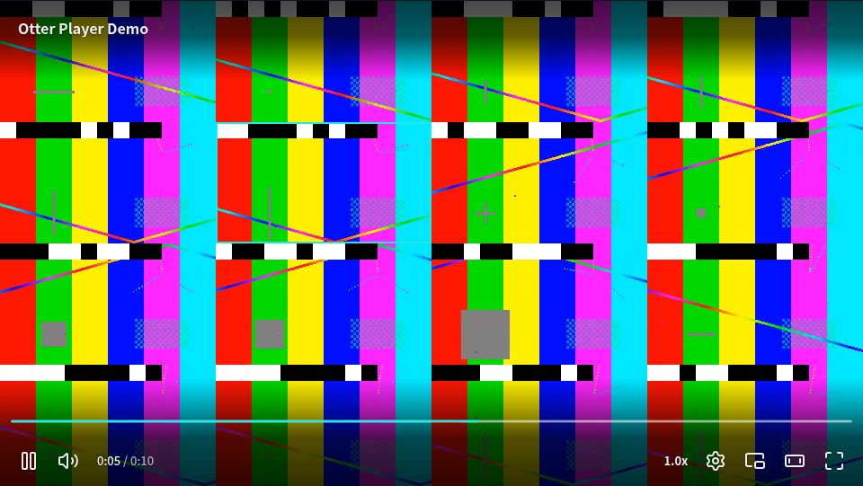
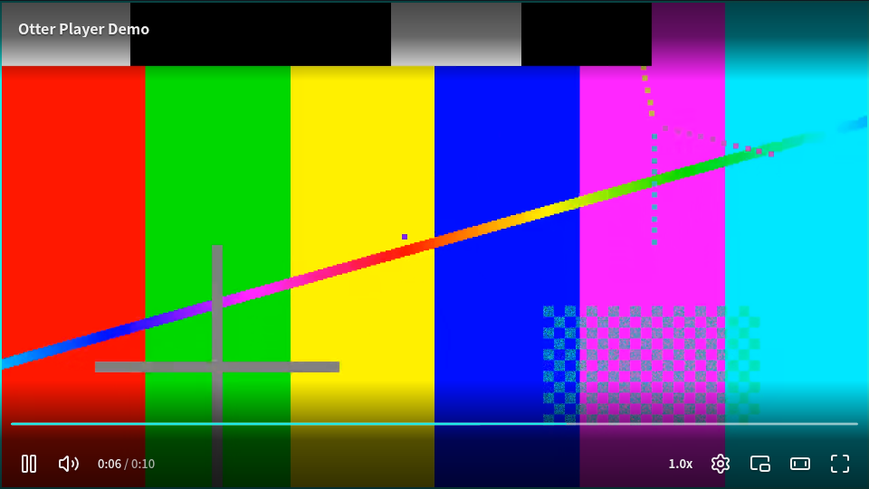

# M4 报告（进行中）

M4 交付时补全；这里先记录各批的结果、Q3 决策材料，以及需要在后续环境里补验的事项。

## 16 路 720p HEVC（播放器外壳，desktop Chrome，2026-10-20 本机）

`player.html?multiview=16`，同一个 10 s、1280×720 HEVC 文件（无 B 帧，每 60 帧一个关键帧，`e2e/media/frames/hevc-720p.mp4`）开 16 个实例，错开起点循环播放。无头 Chrome 没有 HEVC 硬解，各路按降级链走到 WASM（Jessibuca jv4-decoder SIMD 版），在共享解码池的 4 个 Worker 里解码；画面在一张画布上，渲染在 Worker 中。数据由 `e2e/multiview.spec.ts`（`@bench`）测得，原始数据 `docs/reports/m4/multiview-16-hevc-desktop-chrome.json`。CPU 是该路在解码 Worker 里 `decode()` 所用时间占墙钟时间的比例（单核百分比）；「时钟丢帧」是后端按时钟跳过的帧，「画布未显示」是渲染 Worker 取走之前被新帧覆盖的帧。

主线程（10 s）：601 次 rAF，> 20 ms 的 0 次，> 34 ms 的 0 次，最长 16.8 ms，长任务 0 个。机器 16 核，解码池 4 个 Worker，画布 gpu（渲染在 Worker 中）。

| 路 | 解码 | Worker | 10 s 内播放 (s) | 解码帧 | CPU（单核 %） | 时钟丢帧 | 画布未显示 |
|---|---|---|---|---|---|---|---|
| Camera 1 | wasm | 0 | 10.12 | 301 | 18.7 | 1 | 4 |
| Camera 2 | wasm | 1 | 10.12 | 300 | 19.8 | 2 | 4 |
| Camera 3 | wasm | 2 | 10.05 | 301 | 19.2 | 4 | 2 |
| Camera 4 | wasm | 3 | 9.82 | 300 | 19.3 | 5 | 3 |
| Camera 5 | wasm | 0 | 10.08 | 300 | 18.8 | 5 | 6 |
| Camera 6 | wasm | 1 | 10.12 | 301 | 18.8 | 5 | 4 |
| Camera 7 | wasm | 2 | 10.03 | 301 | 18.8 | 6 | 5 |
| Camera 8 | wasm | 3 | 10.13 | 301 | 18.6 | 2 | 4 |
| Camera 9 | wasm | 0 | 10.15 | 301 | 19 | 5 | 5 |
| Camera 10 | wasm | 1 | 10.06 | 301 | 18.6 | 6 | 3 |
| Camera 11 | wasm | 2 | 9.83 | 301 | 18.3 | 4 | 3 |
| Camera 12 | wasm | 3 | 10.04 | 302 | 18.6 | 5 | 2 |
| Camera 13 | wasm | 0 | 9.83 | 301 | 18.8 | 3 | 4 |
| Camera 14 | wasm | 1 | 9.83 | 302 | 18.4 | 6 | 4 |
| Camera 15 | wasm | 2 | 10.11 | 300 | 18.1 | 6 | 3 |
| Camera 16 | wasm | 3 | 9.84 | 301 | 18.4 | 4 | 4 |

局部全屏（双击第 6 路）：

说明：无头 Chrome 的 WebGL 是 SwiftShader（CPU 模拟），渲染与 16 路软解共享 CPU；有 GPU 的真机上画布这一项预计更低。CI 的 Linux runner 只有 4 核，基准在那里跳过并留 notice。

## 三级降级（人为禁用硬解）

播放器外壳 `?prefer=webcodecs&hw=off&wasm=fail` 播本地 H.264 HLS（`e2e/fallback.spec.ts`）：`hw=off` 让 WebCodecs 解码器不接视频（`disableVideo`，等同没有该编码的解码器），`wasm=fail` 让 WASM 解码器的文件缺失。每个环境都按同一顺序降级：

| 环境 | 路径（`router.explain()`） | QoE `error` 事件（剩余步骤） |
|---|---|---|
| desktop Chrome / Firefox / Android 仿真（本机），desktop Safari（CI） | webcodecs selected → webcodecs failed（codecUnsupported）→ wasm selected → wasm failed（workerDecoderFailed）→ mse selected，播放 | codecUnsupported（wasm、mse[、native]），workerDecoderFailed（mse[、native]） |

每次决策另有一条 `route` QoE 事件。只禁用硬解（`?hw=off`）时，HEVC HLS 落在 WASM（Chrome、Android 仿真）；Firefox、Safari 的 MSE 本身能播 HEVC，不经过 WebCodecs。

## surveillance-hevc：从「优雅失败」到可播

`format-hls` 现在也能给 WebCodecs 后端提供 demuxer（mediabunny 读 HLS）。HEVC 源在 MSE 不支持 HEVC 时走 webcodecs → wasm → mse → native：

| 环境 | 公网 `surveillance-hevc`（HEVC + AAC，@network） | 本地 `surveillance-hevc-local`（每次 CI） |
|---|---|---|
| desktop Chrome | wasm（webcodecs codecUnsupported 后） | wasm |
| Android 仿真 | wasm | wasm |
| desktop Firefox | mse | mse |
| desktop Safari（CI） | 未跑（@network 只在 nightly 的 Chrome / Firefox） | mse |

## Q3 材料：自研 CMAF-HLS 引擎与 SPF

拟采用的方向（由项目负责人据此结案）：M5 的 CMAF-HLS 引擎独立实现，不依赖 SPF 运行时，体积对标 SPF。本节回答「SPF 哪些文件能按 L3 拷、哪些要改写、Otter 已有代码能用多少、体积大概多少」。

- SPF 来源：`videojs/video.js@92be7bdd72c8782348ebafc765a23cf8d8cba004` 的 `packages/spf`（`@videojs/spf` 10.1.0）。下文路径都相对 `packages/spf/src/`。
- 行数：`wc -l`，含注释，不含 `tests/`。SPF 非测试源码共 21,542 行：`core` 1,775、`media` 6,436、`network` 600、`playback` 12,501。
- 体积口径：esbuild 0.28.2 打包，minify，ESM，es2022，zlib gzip 默认级别；1 KB = 1000 B（与 size-limit 一致）。SPF 自己的 `scripts/measure-size.js` 用 KiB（1024 B）。

### 要点

1. SPF 分两层。`media/`、`network/` 下多数文件是纯函数，可以按 L3 拷；`playback/` 和 `core/` 建立在 SPF 自己的 signals / actor / reactor / composition 运行时上，只能改写（L4），个别函数可以抽出来。
2. 可拷的主要是 m3u8 解析（约 1,200 行，带 2,100 多行测试）、前后缓冲计划、直播重载节奏、fMP4 `tfdt` 读取。MSE 操作、带宽估计、ABR 与 Otter 已有代码重叠，不需要拷。
3. Otter 已有 MSE sink、ABR 规则栈、LiveController、适配器回退，可以原样复用。缺的是播放列表加载与刷新、分片调度器、分片账本、直播可拖范围。`format-mp4-range` 的引擎是调度器最接近的样板。
4. 「SPF 约 12 KB」在当前 SPF 里找不到出处。实测 SPF 的 HLS 视频引擎约 28 KB gzip，还不含 `signal-polyfill`；SPF 脚本自己的目标是 20 KiB。Otter 按上面的拼法估计 10–14 KB。
5. 体积门禁有冲突，需要负责人先定：ADR-009 写的是「含引擎口径简单点播 < 30KB」，而短视频场景的自有代码现在是 25.88 KB，引擎块只剩约 4.1 KB。

### 1. 可以按 L3 直接拷的 SPF 文件

拷入位置按 REUSE §5：`packages/<引擎包>/src/vendor/video.js/`，每个文件加 `// Derived from videojs/video.js@92be7bd packages/spf/src/<path>`，并写 `UPSTREAM.json`。REUSE §3 要新增一行「HLS 清单解析：video.js SPF，L3」（目前那一行写的是 hls.js `m3u8-parser.ts` 或 `m3u8-parser`，本材料没有比较这两者）。

| 文件 | 行数 | 作用 | SPF 内部依赖 | 处理 |
|---|---:|---|---|---|
| `media/hls/parse-attributes.ts` | 181 | 属性列表、`RESOLUTION`、`FRAME-RATE`、`CODECS`、`EXTINF`、`BYTERANGE` 解析 | 只引用 `types` 里的 `FrameRate` 类型 | L3 直接拷 |
| `media/hls/resolve-url.ts` | 31 | 相对 URL 解析；`EXT-X-KEY` URI 处理（`skd://`、`data:` 原样保留） | 无 | L3 直接拷 |
| `media/hls/parse-multivariant.ts` | 471 | 主清单 → `Presentation`：`STREAM-INF`、`EXT-X-MEDIA` 音轨与字幕、`SESSION-DATA` | `types`、`parse-attributes`、`resolve-url`、`session-data`；`@videojs/utils` 的 `generateId`（11 处） | L3 拷，改类型；`generateId` 换成计数器；可去掉 `session-data` |
| `media/hls/parse-media-playlist.ts` | 463 | 媒体清单 → 分片列表：`EXT-X-MAP`（含 BYTERANGE）、`BYTERANGE`、PDT、`EXT-X-KEY` 记录、`HOLD-BACK`、LL-HLS 标记、`ENDLIST`；直播重载时按 PDT 或 media-sequence 把新窗口接到旧时间线上 | `types`（`getMediaPlaylistMetadata`、`isResolvedTrack`）、`parse-attributes`、`resolve-url`；`@videojs/utils` 的 `isUndefined` | L3 拷，改类型。注意：不处理 `EXT-X-DISCONTINUITY`、`EXT-X-START`、`EXT-X-GAP`、LL-HLS part（只置 `lowLatency` 标志）；`.ts` / `.aac` 分片被标成不可播放 |
| `media/hls/reload-policy.ts` | 79 | 直播清单重载间隔（窗口没变就半个 target duration）；目标延迟取 `HOLD-BACK`，缺省 3 × target duration | `types`、`utils/tracks` 的 `findTrackById` | L3 拷，改成直接收 track |
| `media/types/index.ts` | 599 | CMAF-HAM 数据模型（Presentation / SelectionSet / SwitchingSet / Track / Segment）与类型守卫 | 无 | 只拷解析器用到的子集；也可以改成 Otter 自己的内部模型 |
| `media/utils/tracks.ts` | 264 | 按 id / 类型找轨道、`buildMimeCodec`、codec family | `types` | 部分拷（`buildMimeCodec`、`getCodecFamily`） |
| `media/buffer/forward-buffer.ts` | 187 | `getSegmentsToLoad`：前向窗口内哪些分片要加载（会补 seek 后的空洞）；`calculateForwardFlushPoint`；时间区间合并 | `types`（`Segment`、`SEGMENT_TIME_EPSILON`） | L3 直接拷 |
| `media/buffer/back-buffer.ts` | 75 | 后向缓冲：保留最近 N 个分片，算出清除点 | `types` | 可拷；也可以继续用 MSE sink 按秒清除，二选一 |
| `media/live-window.ts` | 44 | 从分片列表得到直播窗口 `[start, end]`；VOD 返回 null | `types`、`utils/tracks` | L3 直接拷 |
| `media/mp4/box.ts`、`media/mp4/timestamp-origin.ts` | 93 + 112 | 遍历 box；读 init 的 `mdhd.timescale` 和分片的 `tfdt.baseMediaDecodeTime` | 无 | L3 直接拷。Otter vendored 的 hls.js `mp4-tools.ts` 只保留了 box 类型常量和 SEI 解析，没有 box 遍历和 `tfdt` 读取 |
| `media/dom/mse/end-of-stream.ts` | 43 | `isLastSegmentAppended`：按分片 id 判断能否 `endOfStream()` | 无 | L3 直接拷 |
| `network/retry.ts` | 91 | 首字节超时、指数退避、只重试 5xx 与网络错误 | `@videojs/utils` 的 `anyAbortSignal`（换成 `AbortSignal.any`） | L3 拷。SPF 只在 DRM 许可证请求里用它，分片请求没有重试（只有多 CDN 切换）；Otter 可以用在分片上 |
| `network/fetch.ts`、`network/chunked-stream-iterable.ts` | 159 + 59 | 带 Range 的请求、按块流式读取、按块采样带宽 | `bandwidth-estimator` | 可选。Otter 引擎目前都是内联 `fetch`，mp4-range 的写法已够用 |

这些文件配套的测试也可以拷：`parse-media-playlist.test.ts` 1,307 行（63 个用例）、`parse-multivariant.test.ts` 802 行（35 个）、`forward-buffer.test.ts` 438 行（30 个）、`back-buffer.test.ts` 211 行（14 个），另有 7 个 m3u8 夹具。Otter 同样用 Vitest。

### 2. 必须改写或不需要的部分

改写（L4，或只抽个别函数）：

| 文件 | 行数 | 作用 | SPF 内部依赖 | 处理 |
|---|---:|---|---|---|
| `playback/actors/dom/segment-loader.ts` | 462 | 每个 SourceBuffer 一个加载 actor：规划任务、串行拉取并追加 | `createMachineActor`、`SerialRunner` / `Task`、`peek` | 改写。其中 `planTasks`（约 100 行）基本是纯计算：前后清除、换语言时标记过期区间、降档时保留更高码率的已缓冲分片，可以抽成函数按 L3 拷 |
| `playback/actors/dom/source-buffer.ts` | 286 | SourceBuffer actor，并记录「哪些分片（id、轨道、码率）已在缓冲里」 | actor、`Task`、`append-segment`、`buffer-flusher` | 改写。Otter 的 MSE sink 只有时间区间，需要补一个分片账本（估计 50 行左右） |
| `playback/primitives/segment-load-pipeline.ts` | 203 | 拉取 → 追加的步骤管线，可插入重定位步骤 | `effect`、signals、composition 类型 | 改写为普通 async 循环 |
| `playback/behaviors/resolve-presentation.ts`、`resolve-track.ts` | 139 + 387 | 拉主清单、拉媒体清单、直播定时重载 | composition、signals、CDN 回退 | 改写（普通 async + 定时器） |
| `playback/behaviors/dom/load-segments.ts`、`setup-buffer-actors.ts`、`setup-mediasource.ts`、`update-mediasource-duration.ts`、`end-of-stream.ts`、`track-current-time.ts`、`track-load-triggers.ts` | 355 + 309 + 239 + 164 + 279 + 79 + 154 | 把元素事件、MediaSource、加载 actor 串起来 | composition、reactor、signals、DOM | 改写，对应 Otter 引擎里的调度循环 |
| `playback/behaviors/track-switching.ts` | 1,040 | 视频 / 音频 / 字幕选轨：约束 → 偏好 → 按带宽排序 | `defineBehavior`、`createMachineReactor`、signals | 不拷。ABR 用 Otter 规则栈；「同 codec 不跨族」「按播放器尺寸封顶」可以参考（L4） |
| `playback/primitives/selection-rules.ts` | 224 | `applyRules`、`excludeUnplayableTracks`、`preferCodecFamilies` | 只引用 signals 类型；DRM 规则读一个 signal | 可选。按 codec 过滤 variant 这一步 Otter 也要做 |
| `playback/behaviors/dom/seek-to-live-edge.ts`、`sync-live-seekable-range.ts` | 193 + 86 | 起播位置定在 `HOLD-BACK`；掉出窗口时拉回；`setLiveSeekableRange` | reactor、signals | 改写。追帧已有 LiveController；可拖范围 Otter 还没有 |
| `playback/behaviors/dom/recover-end-stall.ts` | 120 | Chrome 在音视频结束点相差几十毫秒时停在末尾不发 `ended`，在 `waiting` 时把 `currentTime` 推到 `duration` | signals、DOM | 只借做法（约 20 行） |
| `playback/behaviors/establish-start-media-time.ts`、`primitives/relocation-pipelines.ts`、`primitives/head-peek.ts` | 338 + 275 + 49 | 非零起始 PTS：读 `tfdt`，用 `timestampOffset` 把时间线平移到 0 | reactor、signals、composition | 先决定要不要平移。Otter 的 mp4-range 和 FLV/TS 管线都保留源时间戳 |
| `core/**` | 1,775 | signals、actor、reactor、task、composition 运行时 | `signal-polyfill` | 不需要 |
| `playback/engines/hls/engine.ts` | 519 | 把 36 个 behavior 组合成引擎 | 全部 | 不需要，Otter 用自己的 `Engine` 契约 |

不需要（Otter 已有别的做法，或 M5 首批不做）：

| 部分 | 行数 | 原因 |
|---|---:|---|
| DRM：`media/drm.ts`、`media/dom/eme.ts`、`key-systems.ts`、`license-sessions.ts`、`license-transforms.ts`、`fairplay-legacy.ts`、`behaviors/dom/setup-media-keys.ts`、`exchange-licenses.ts`、`setup-airplay-fairplay.ts` | 2,711 | SPEC §7：DRM 只走 Shaka。这部分 Mux 相关的约定最多（`skd://mux?...`、许可证格式） |
| AirPlay：`behaviors/dom/airplay.ts` | 375 | `backend-mse/src/mms.ts` 已统一处理 AirPlay 备用源与 MMS 前提 |
| 字幕分片、cue 同步、轨道槽位（`text-track-*`、`sync-text-tracks.ts`、`resolve-vtt-segment.ts` 等） | 约 1,100 | M5 首批不做 HLS WebVTT；以后用 `text` 包解析，加载部分改写 |
| 章节（`parse-json-chapters.ts` 等） | 391 | 不在 M5 范围 |
| 多 CDN 回退（`utils/cdn.ts`、`derive-cdn-priority.ts`、`setup-failover-monitor.ts`、`failover-fetch.ts`） | 349 | 不在 M5 范围 |
| `adapters/**`（HTMLMediaElement 外观） | 1,816 | Otter 有 session 与 backend |
| `network/ewma.ts`、`bandwidth-estimator.ts`、`media/abr/quality-selection.ts` | 74 + 162 + 31 | 与 `pipeline/src/vendor/hls.js/ewma.ts` 和 ABR 规则栈重叠 |
| `media/dom/mse/append-segment.ts`、`buffer-flusher.ts`、`mediasource-setup.ts`、`duration.ts` | 99 + 60 + 294 + 133 | 与 `engine-pipeline/src/mse-sink.ts`、`backend-mse` 重叠。`append-segment.ts` 里中断流式追加后调用 `sourceBuffer.abort()` 的处理值得补进 sink |
| `media/errors.ts`、`behaviors/collect-errors.ts` | 171 + 135 | SVTA 错误码体系；Otter 用 `OtterError` |

### 3. Otter 现有代码能用多少

CMAF 分片本身就是 fMP4，可以直接追加给 MSE，不需要转封装。

| Otter 代码 | 行数 | 现状 | 用于 CMAF-HLS 引擎 |
|---|---:|---|---|
| `packages/engine-pipeline/src/mse-sink.ts` | 208 | 每个 SourceBuffer 一个串行队列；`segments` 模式；codec 变化时 `changeType`；`QuotaExceededError` 时先清后缓冲再重试一次；按秒清后缓冲；`endOfStream` 等队列排空 | 原样用。缺：分片账本、`timestampOffset`、中断追加时的 `abort()`、`setLiveSeekableRange` |
| `packages/engine-pipeline/src/fallback.ts` | 81 | `withAdapterFallback(primary, createFallback)`：自研引擎因媒体原因失败时换适配器重建一次，网络错误不回退 | 原样用，回退到 hls.js |
| `packages/engine-pipeline/src/index.ts` | 312 | FLV / TS 单条长连接引擎；接 LiveController、CEA-608 | 不是分片引擎。`mediaSourceCtor`、就绪 / `first-segment` / 错误映射的写法可以照搬 |
| `packages/pipeline/src/abr/`（`abr.ts`、`driver.ts`、`defaults.ts`）+ `vendor/dash.js/`（BOLA、Throughput、InsufficientBuffer、Dynamic）+ `vendor/hls.js/ewma.ts` | 312 + 411 + 110 | 规则栈；`createAbrDriver` 收下载样本、按快照做决定，hls.js 适配器和 mp4-range 都在用 | 原样用：每个分片下载完调用 `sampleDownload`，选下一个分片前调用 `decide` |
| `packages/pipeline/src/live/controller.ts` + `vendor/mpegts.js/live.ts` | 88 + 71 | 追帧、动态倍速、起播卡顿跳转、回到直播 | 原样用，目标延迟改成从 `HOLD-BACK` 取 |
| `packages/pipeline/src/transmux/transmuxer.ts` + `vendor/hls.js/` | 273 + 6,767 | TS → fMP4 | CMAF 不需要。以后要支持 TS 分片的 HLS 时可以接上（SPF 不支持 TS），按需加载块 29.38 KB，每个不连续点要 `reset()` |
| `packages/pipeline/src/captions/` + `vendor/hls.js/cea-608-parser.ts` | 98 + 1,508 | 608 解码；cc_data 目前由 TS 转封装器从 SEI 里取 | fMP4 里的 608 需要另写从 `mdat` 取 SEI 的代码，首批可以不做 |
| `packages/backend-mse/src/` | 277 | 承载引擎；MMS / AirPlay 前提统一处理 | 原样用 |
| `packages/format-mp4-range/src/engine.ts` | 372 | Range 分段引擎：`epoch` 取消、`pump` / `step` 循环、seek、ABR 切档时按各 SourceBuffer 的末尾分别找切点 | 调度器最接近的样板，照它的结构写 |
| `packages/format-hls/src/index.ts` | 56 | 现在选 hls.js 或 Shaka；WebCodecs 走 mediabunny | 增加自研引擎分支，外面包 `withAdapterFallback` |
| `packages/media/src/format.ts` | 97 | `FormatPlugin` / `Engine` / `EngineContext`（含 `cmcd`、`mms`） | 契约不用改 |

还缺、需要新写的部分：

1. 播放列表加载与刷新：拉主清单和媒体清单，直播按 `reload-policy` 定时重载。解析器和重载间隔可以拷，加载循环要写。
2. 分片调度器：用 `getSegmentsToLoad` 决定拉哪些分片；切换 init；处理 seek、切档、结束（`isLastSegmentAppended`）；配一个分片账本。
3. variant 过滤：按 MSE `isTypeSupported` 或 Otter 的能力探测去掉放不了的 codec，再交给 ABR。
4. 轨道映射：把 variant 和音轨映射成 Otter `TrackList`，发 `quality-change`，实现 `selectAudioTrack`。
5. 直播：起播位置、`setLiveSeekableRange`、接 LiveController。
6. 时间线：决定是否用 `timestampOffset` 把非零 PTS 平移到 0（SPF 平移，Otter 现有引擎不平移）。
7. 不支持的情况交回 hls.js。SPF 也不覆盖这些：`EXT-X-DISCONTINUITY`、I-frame 清单（Otter 的 hls.js 适配器用它做缩略图）、LL-HLS part、AES-128（SPF 遇到非 DRM 的 `EXT-X-KEY` 报 `SVTA_UNSUPPORTED_ENCRYPTION_METHOD`）、TS 分片、内容导向。建议解析器遇到这些就报「不支持」，由 format 选 hls.js。

工作量粗估：拷入约 1,500 行（大部分是解析器），新写 500–700 行（参照 mp4-range 引擎的 372 行，再加播放列表循环和直播部分）。这是估计，没有原型验证。

### 4. 体积

SPF 实测。SPF 外部依赖的处理：`@videojs/utils`、`@videojs/media` 用同功能的小实现替代（打包后约 0.9 KB minified）；`signal-polyfill` 本机没有，也不能联网，**未计入**。SPF 自己用 `vp pack`（rolldown）构建，本机没有 vite-plus，跑不了它的脚本，两种 minifier 的差别没有核对。

| 条目 | min | gzip |
|---|---:|---:|
| `playback/engines/hls/index.ts`（SPF `size` 脚本的入口，含视频、纯音频、背景视频三个引擎） | 95.3 KB | 30.01 KB |
| 只导出 `createHlsVideoEngine` | 89.2 KB | 27.95 KB |
| 只导出 `createHlsAudioEngine` | 62.5 KB | 19.65 KB |
| 只导出 `createBackgroundVideoEngine`（只有视频、不做 ABR、无字幕、无 DRM） | 45.9 KB | 14.85 KB |
| `core` 运行时（composition、signals、task、actor、reactor） | 5.1 KB | 1.98 KB |

视频引擎 89.2 KB minified 的构成：DRM 相关约 14.6 KB（16%），`playback/behaviors/dom` 约 21.0 KB（24%），`media/hls` 解析器约 10.4 KB（12%），`core` 运行时约 5.2 KB（6%）。前两项有重叠（`setup-media-keys.ts` 等 DRM behavior 也在 `behaviors/dom` 下）。`scripts/measure-size.js` 的目标是 20 KiB；README 和 `docs/` 里没有体积数字。SPEC §8 的「对标 SPF 12KB」在这个版本里找不到出处，建议改成实测值。

Otter 拼装件实测（`@otter-player/core`、`media` 已在首屏，不计）：

| 部件 | gzip |
|---|---:|
| SPF m3u8 解析（主清单 + 媒体清单 + 属性 + URL + 重载策略，原样） | 4.04 KB（只有媒体清单解析：2.49 KB） |
| SPF 前后缓冲计划 | 0.51 KB |
| Otter MSE sink | 1.05 KB |
| Otter ABR：完整规则栈 + driver | 2.98 KB（只用 Throughput + InsufficientBuffer + EWMA：1.55 KB） |
| Otter LiveController | 0.69 KB |
| 参照：`format-mp4-range/src/engine.ts` 自身（调度、seek、切档胶水，共享包不计） | 3.21 KB |
| 组合：解析器 + 缓冲计划 + sink + 精简 ABR | 6.61 KB |
| 组合：解析器 + 缓冲计划 + sink + 完整 ABR | 8.15 KB |
| 组合：上一行 + LiveController + `live-window` + `timestamp-origin` | 9.39 KB |

估计（假设新写的调度和引擎胶水与 mp4-range 引擎相当，3–4 KB；直播刷新和可拖范围再加 0.5–1 KB）：

| 形态 | 估计 gzip |
|---|---:|
| 只做点播，精简 ABR | 10–11 KB |
| 点播，完整 ABR | 11–12 KB |
| 点播 + 直播 | 13–14.5 KB |

对照：hls.js 1.7.3 `hls.min.mjs` gzip 181.3 KB，`hls.light.min.mjs` 115.7 KB。

和门禁的关系：ADR-009 的 M5 验收是「含引擎口径简单点播 < 30KB」。按本机现有 dist（与 HEAD `4d320de` 同时构建）跑 size-limit，短视频场景自有代码 25,883 B（25.88 KB），留给引擎块的只有约 4.1 KB。上面任何一种形态都放不下；SPF 原样也放不下。长视频点播场景自有代码 29.74 KB，上限 80 KB，没有问题。

### 5. 建议与取舍（由负责人决定）

| 方案 | 做法 | 好处 | 代价 |
|---|---|---|---|
| A | L3 拷 SPF 的解析器、缓冲计划、重载策略、`tfdt` 读取；MSE sink、ABR、LiveController、回退用 Otter 已有的；调度器参照 mp4-range 新写 | 符合「独立实现」；运行时只有 Otter 自己的；估计 10–14 KB；解析器带 100 个左右现成测试 | 拷来的约 1,500 行要跟上游（CHANGELOG 记了 42 个版本，2026-10 一个月内发了 10.0.0、10.0.1、10.1.0）；要把 CMAF-HAM 类型改成 Otter 的；`DISCONTINUITY`、AES-128 等不支持的情况要回退 hls.js |
| B | 完全自写，只借设计（L4） | 数据模型从一开始就是 Otter 的 | m3u8 的边角情况（BYTERANGE 续接、PDT 插值、直播窗口接续）要自己踩一遍；测试也要自己写 |
| C | L1 依赖 `@videojs/spf` | 现成，功能更全（DRM、字幕、多 CDN） | 不符合 Q3 前提；约 28 KB 加 `signal-polyfill`；SPF 自己管 MediaSource 和错误码，和 Otter 的 backend、ABR、QoE 分层冲突 |

建议 A。理由：可拷的部分正好是纯函数、容易出错、带测试的那一层；和运行时绑定的部分，Otter 已经有等价物，或者 mp4-range 已经是同样结构的样板。

需要负责人定的事：

1. 简单点播「含引擎 < 30KB」怎么处理：首屏自有代码再减 6–10 KB；或者改为只对引擎块单独设预算（例如 ≤ 12 KB）；或者简单点播的 HLS 默认走 native / mp4-range，自研引擎只承担长视频点播。
2. 首批范围：只做点播，还是同时做直播。估计相差 2–3 KB，另外多出 `setLiveSeekableRange`、窗口接续、HOLD-BACK 起播这些工作。
3. 非零 PTS 用不用 `timestampOffset` 平移到 0。
4. 引擎放在哪：新包，还是 `format-hls` 内的按需块。
5. SPEC §8 的「对标 SPF 12KB」是否改成实测值。

附：核对记录（2026-10-21）。`parse-media-playlist.ts` 463 行、`parse-multivariant.ts` 471 行、`forward-buffer.ts` 187 行、`segment-loader.ts` 462 行、`track-switching.ts` 1,040 行，与上表一致；`parse-media-playlist.test.ts` 64 个用例（表格写「63 个用例」，以 64 为准）；`scripts/measure-size.js` 的 `targetKB = 20`，与「20 KiB 目标」一致；SPF 源码里没有出现「12 KB」，「12KB」只在 Otter 的 SPEC / RESEARCH 里；`media/hls/` 的解析器里没有 `EXT-X-DISCONTINUITY`、`EXT-X-START`、`EXT-X-GAP` 的处理：`DISCONTINUITY` 只出现在 `parse-media-playlist.test.ts` 的一个夹具里，`EXT-X-START` 只出现在 `playback/behaviors/dom/apply-start-position.ts` 的注释里（作为以后可以建在 `startPosition` 之上的功能），与「解析器不处理」的判断一致。

## 待验项

| 项 | 原因 | 在哪里验 |
|---|---|---|
| 真实 Firefox 的 AudioContext 时钟 | Linux 无头 Firefox 的 `resume()` 永远不返回（RESEARCH §1），e2e 在那里只验证了备用时钟与 `audioClockUnavailable`；AudioContext 作为主时钟、5 秒空闲挂起后再 `resume()` 的路径未在 Firefox 上跑过 | Windows 真机一轮（inst-01m4r7vv…，Firefox 与 Edge） |
| 运行时降级（播放中 WebCodecs 出错切 WASM） | 未实现；目前播放中的解码错误由 session 走同一条链重建（ADR-008 §5） | 后续批次 |
| WebCodecs 路径的 HLS 没有 ABR | 取最高码率变体（ADR-008 §5） | 自研 CMAF-HLS 引擎（M5）时一起考虑 |
| 多宫格在真机（有 GPU、有 HEVC 硬解）上的数据 | 本机是无头 Chrome + SwiftShader + WASM 软解；硬解时各路走 WebCodecs，CPU 与画布开销都应更低 | Windows 真机一轮 |
| 无 WebGL2 时的多宫格 | 每路一个 2D canvas 在主线程绘制，16 路 720p 时主线程约 10 fps（无头 Firefox） | 后续：2D 兜底也移到 Worker（OffscreenCanvas 2D），或限制路数 |
| WebKit 上 GPUSurface 的色彩管理 | WebKit 对 `<video>` 做色彩管理、对 WebGL 上传不做，e2e 对该路径拟合颜色映射（ADR-008 §6 已知限制） | 后续 HDR / 色彩管理批次 |
