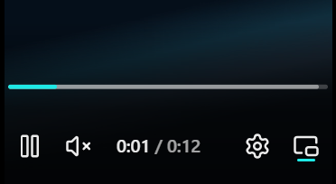
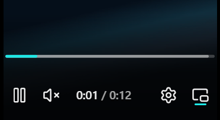
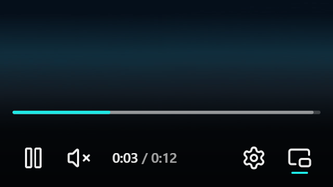
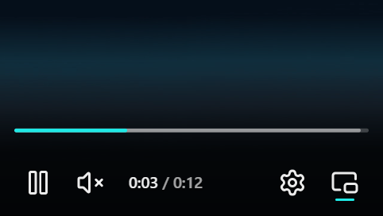
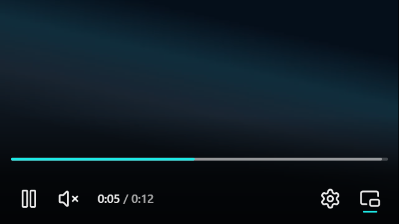
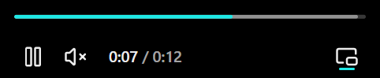

# 伴随模式（companion mode）报告

- 状态：第 0–3 停已交付，**提请负责人目视验收**
- 关联：需求 `docs/design/COMPANION.md`；契约 ADR-016；实测 RESEARCH §1「伴随模式第 0 停」与「真 Edge 补量」；SPEC §15.1
- 基线：`624518a`；全部提交直接在 main
- 日期：2026-11-11 至 2026-11-16

## 1. 提交与 CI

| 提交 | 内容 | CI |
|---|---|---|
| `5c312bb` | 第 0 停：需求归档、ADR-016 提议、SPEC §15.1、GLOSSARY、RESEARCH 实测、探针 | #287 红：e2e chromium + firefox 的 `playwright install` 一步退出码 1，后续步骤没有浏览器（基础设施，同代码的夜间 #289 绿） |
| `e3596a4` | 内部文件 `companions.ts` 改名 `helpers.ts` | 与下一行同一次推送 |
| `e1da063` | ADR-016 采纳（各冲突取建议项） | #288 红：同 #287 |
| `aa8cb23` | 第 1 停：状态与动作、暗化、三档尺寸、偏好、悬停精简栏 | #290 被夜间 #291 取消（同一并发组）；#291 跑同一代码，全绿 |
| `97e87f7` | 修复：PiP 小窗里的节点属于小窗的 realm，`instanceof` 失效（菜单、语言、按键） | 与下一行同一次推送 |
| `1119ccf` | 修复：PiP 文档没有 title / lang（axe serious） | 同上 |
| `a2d3575` | 第 2 停：音频条、quiet、关窗、设置页 | #293 全绿 |
| `8be4d59` | 真 Edge 补量（文档） | #295 绿（只改文档，e2e 按规则跳过） |
| `a1c2547` | 第 3 停：退化与 WebCodecs 用例、`@example`、文档站一页、changeset | #296 全绿 |
| `80ba439` | 修复：≤ 300 px 宽的小窗里精简栏折成两行；目视材料探针 | 见汇报 |
| 本报告 | — | 见汇报 |

Pages 自 `624518a` 起每次都红（第 13–17 次）：ADR-015 的冻结检查要求 `packages/` 与 `56893d2` 相同，任何包改动都会被拦下。这不是本任务引入的，未处理（约束：不动公开站的构建）。

## 2. 验收逐条

判定项目：desktop-chrome（CI 与本机）和真 Edge。真 Edge 用的是负责人局域网里的 Windows 机器（见第 4 节），不是任务指定的云实例。

| # | 验收 | 结果 | 依据 |
|---|---|---|---|
| 1 | 暗化：小窗内计算不透明度 = 设置值，回页面 = `1 - brightness`；像素核对 | ✅ | `e2e/companion.spec.ts`。计算值：小窗 0.4，回页面 0。像素比（小窗 / 页面）在暗化 0 / 0.4 / 0.8 时：desktop-chrome 0.999 / 0.600 / 0.200，真 Edge 0.996 / 0.598 / 0.199 |
| 2 | 进出不断播（跳变 ≤ 0.5 s）；WebCodecs 进出无音频欠载 | ✅ | 每 50 ms 采样播放头，进出全程不停、不回跳、相邻样本不超过墙钟 + 0.5 s。WebCodecs（`player.html?companion=1`，有声片源）：desktop-chrome 48 个样本、真 Edge 46 个样本，`audioUnderrun` 0 次 |
| 3 | 刷新后 dim / size / audioOnly 恢复；进出一次后 textLanguage 与 danmaku 逐字节相同 | ✅ | e2e：刷新后恢复 0.6 / l / true；进出前后两字段的 JSON 相同。另一条 e2e：quiet 关掉、再恢复字幕，textLanguage 不变。弹幕的 quiet 由单测覆盖（vod 页面没有弹幕插件） |
| 4 | 退出后恢复原状 | ✅ | 字幕回到进入前的轨（e2e）；弹幕回到进入前（单测）；控件 3 s 后重新自动隐藏；`documentPictureInPicture.window` 为空；页面里没有 `style[data-otter-companion-style]`、`[data-otter-companion]`、占位节点；destroy 后所有 MediaSource 为 closed |
| 5 | 指针不在小窗内播放 5 s 控件不可见；进入可见；键盘可到达全部控件 | ✅ | e2e：每 0.5 s 查一次，共 10 次都不可见；指针进入后可见，停留 3.5 s 仍可见；移出即隐藏；Tab 依次到达播放、静音、进度、设置、回页面，到达时控件可见，被隐藏的按钮到达不了 |
| 6 | desktop-firefox、desktop-safari、emulated-iphone：`supported` 为 false，`toggle-pip` 走视频 PiP 或既有规则，没有错误事件 | ✅（Firefox 见下） | e2e「without Document PiP」：Safari 与 iPhone 本来没有这个 API，WebKit 拒绝打开视频 PiP 窗口，已回滚并发 `presentation-denied`，没有 error 事件。desktop-firefox 上用 init script 去掉 API 后照同样规则判（CI #296 绿）。Playwright 自带的 Firefox 本身是否提供 Document PiP **没有看到**：本机这个 Firefox 起不来，CI 页面上的通知被折叠。另：iframe 内 `supported` 为 false（e2e） |
| 7 | 首屏 ≤ 30 KB 不变并报余量；伴随按需块单列 | ✅ | 首屏 27.00 / 30 KB（基线 26.49，余量 3.00 KB）。伴随按需块（presentation `companion` + presets `companion-style`）1.76 / 3 KB，`.size-limit.js` 单列 |
| 8 | 只在 desktop-chrome 与真 Edge 判定；emulated-android 只记录 | ✅ | 两处各 14 条全过。其他项目跳过并留通知（`supported=…`），只判退化用例 |
| 9 | 目视材料：三档尺寸、音频条、暗化 0 / 40 / 80 %、最小档设置页，中英文各一组 | 提请验收 | 第 3 节 |

## 3. 目视材料（真 Edge 157，`80ba439`）

截图是小窗的内容区，不含浏览器标题栏；屏幕缩放 150 %，所以图片像素是窗口尺寸的 1.5 倍。用 `e2e/probes/companion-visuals.probe.ts` 生成，可以重跑。三档尺寸那几张是指针在小窗里（控件显示）时截的；暗化那几张是暂停在同一帧、指针在外面（控件隐藏）。

| 项 | English | 中文 | 小窗内容区（px） |
|---|---|---|---|
| 尺寸 s |  |  | 248×135（Edge 最窄 248） |
| 尺寸 m |  |  | 320×180 |
| 尺寸 l |  |  | 441×248 |
| 音频条（m） |  |  | 321×66 |
| 暗化 0 % |  |  | 320×180 |
| 暗化 40 % |  |  | 同上（±2） |
| 暗化 80 % |  |  | 同上（±2） |
| 最小档的设置页 |  |  | 248×135 |

请重点看：

- 最小档（s）的精简栏。第一轮截图里，5 个控件在 248 px 宽时折成了两行，挡住大半画面。`80ba439` 修了：窗口宽 ≤ 300 px 时按钮改为 32 px。上面是修后的图。
- 最小档的设置页。它在窗口里铺成一层面板，四周留 8 px，可以滚动；「80 %」那一格会折到第二行。这是 248 px 宽的结果，要不要改由负责人定。
- 音频条上没有设置按钮（需求第 5 条的列表里没有它）。要关掉音频条，回到页面后在设置里改。

## 4. 真机

- **云实例** `inst-01m4skyh174y47p9n6yhxdy7at`：没有连上。工作副本是新 clone 的，`tmp/env`、`tmp/win.py` 都不存在。按要求没有另建实例。
- **负责人改为提供局域网 Windows 机器**（192.168.1.2）：
  - 硬件：Windows 11 专业版，i5-13500H，Intel Iris Xe（另有 MuMu 虚拟显示适配器），内存 15.7 GB，2560×1600 屏、缩放 150 %。
  - 浏览器：Edge 157.0.4341.46。Playwright 的 Desktop Edge 设备描述会把 UA 改成 156。
  - 做法：通过那台机器上的 go-agent-platform `vm-agent`（7070 端口）远程执行命令；仓库 clone 在那台机器上，测试站跑在它的 `localhost`。
  - 2026-11-15 13:28 左右，vm-agent 被换成新版本（`0.1.0-dev+remote.2`）并重启。这不是本任务的操作。重启停掉了正在跑的测试站服务，重新启动后继续。
- **真 Edge 上的结果**：
  - 第 0 停的六项全部补量，见 RESEARCH §1「真 Edge 补量」。
  - `e2e/companion.spec.ts` 在 `80ba439` 上 14 条全过：第 1–2 停的 11 条，加上 WebCodecs、退化、iframe 三条。
  - 截图时还看到一个现象：同一尺寸反复打开，Edge 恢复上次的窗口尺寸时有约 1 px 的累积取整误差（320 → 321 → 322）。只记录，不处理。

## 5. 与需求的偏离、未完成项

1. **ADR-016 采纳方式**：负责人回复「那你就继续做呗」后，按 ADR 写的建议项执行；批准记录在 ADR 末尾。
2. **「回到页面」不改变播放状态**：在播的继续播，暂停的保持暂停。需求写的「继续播放」按这个理解实现，请确认。
3. **「省 CPU」的写法**：Chromium 与真 Edge 结论一致，按 ADR-016 冲突 7 (a)，文档（文档站一页）写的是「隐藏画面后合成与上屏的 CPU 下降，解码不变」，没有写「省电」或笼统的「省 CPU / GPU」。
4. **切走标签页自动进小窗**（只量不做）：Chromium 156 和 Edge 157 都接受 `enterpictureinpicture` 这个动作，但真实切换标签页后都没有调用。需要什么条件没有查到。
5. **desktop-firefox 的事实**仍未确认，见验收第 6 条。
6. **本机 e2e 的环境问题**：本机 desktop-chrome 上，5 个文档示例和 basic preset 偶尔停在 0.2–0.3 s。在 HEAD 上不带本任务改动也一样；CI 上通过。原因没查。
7. **普通 docpip 的已知问题**：页面的样式表会复制进小窗（`docpip.ts`），包括宿主的 body 内边距和播放器宽高比，所以普通 docpip 在小窗里铺不满。伴随模式用只加在小窗里的样式解决了；普通 docpip 没有动，要不要另修，请负责人定。

## 6. 文件

- 产品代码：
  - `packages/presentation/src/companion.ts`（按需块）
  - `packages/presentation/src/plugin.ts`、`controller.ts`、`docpip.ts`
  - `packages/ui-core/src/player-ui.ts`、`elements.ts`、`settings-level.ts`、`strings.ts`
  - `packages/preferences/src/index.ts`
  - `packages/presets/src/companion-style.ts`（按需块）、`player.ts`、`basic.ts`、`tv.ts`
  - `packages/input/src/controller.ts`
- 测试：
  - 单测：`packages/presentation/test/companion.test.ts`、`packages/ui-core/test/companion.test.ts`、`packages/ui-core/test/realm.test.ts`、`packages/preferences/test/preferences.test.ts`、`packages/input/test/controller.test.ts`
  - e2e：`e2e/companion.spec.ts`
  - 探针：`e2e/probes/companion.probe.ts`、`e2e/probes/companion-visuals.probe.ts`
- 示例与文档：
  - `e2e/site/companion.html`、`e2e/site/examples/companion.ts`
  - `docs-site/guides/companion.md`
  - `.changeset/pre/companion-mode.md`、`.changeset/pre/docpip-window-fixes.md`
